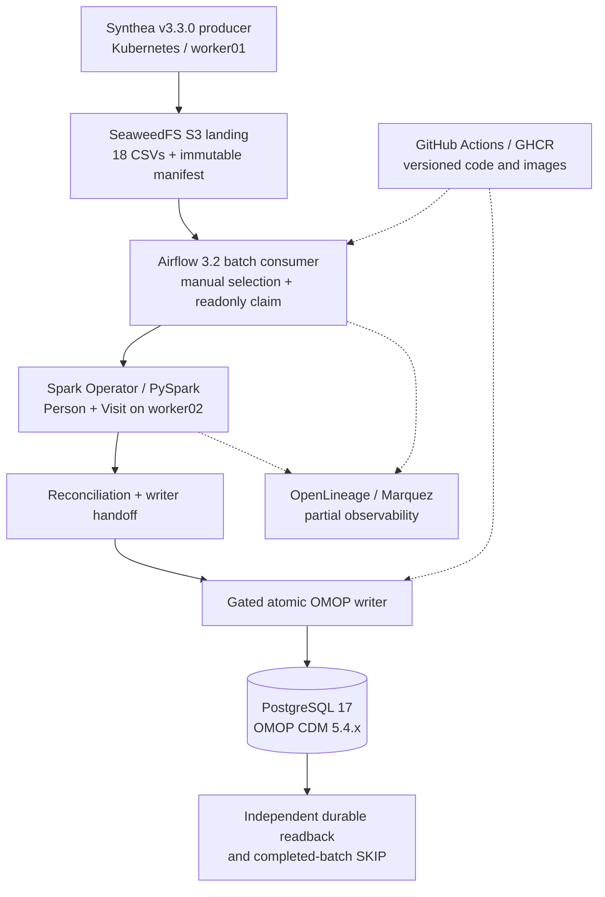

# Healthcare Data Platform
### Kubernetes-native clinical data engineering | OMOP CDM | Hybrid analytics roadmap

A hands-on healthcare data engineering platform that ingests **synthetic clinical data**, validates immutable batches, transforms patient and encounter records with **PySpark**, and persists standardized **OMOP CDM 5.4** data in **PostgreSQL**. The verified runtime combines **Kubernetes, SeaweedFS (S3-compatible object storage), Apache Airflow, Spark Operator, Python, and GitHub Actions**.

The broader architecture is designed to extend into **Microsoft Fabric / OneLake, Azure storage, FHIR and HL7 ingestion, dbt, and ML feature engineering**. Those extensions are part of the roadmap—not claims about components already deployed or production-tested in this repository.

**项目导航（中文）**：[新文档入口](documents/README.md) · **[当前项目状态](documents/engineering/status/PROJECT-STATUS.md)** · [当前总体架构](documents/architecture/SYSTEM-OVERVIEW.md) · [AI/Agent 协作规则](documents/engineering/development/AGENT-RULES.md) · [运维](documents/engineering/operations/README.md) · [架构决策](documents/architecture/decisions/README.md) · [历史 Agent 文档](https://github.com/JohnZhang-DataForge/healthcare-data-platform/blob/49936b51d4beadc69383e931efc3e72d2f0db47e/docs/README.md) · [历史任务状态（非当前）](https://github.com/JohnZhang-DataForge/healthcare-data-platform/blob/49936b51d4beadc69383e931efc3e72d2f0db47e/docs/tasks/TASK-STATUS.md) · [已完成的 Airflow → OMOP 真实验收](https://github.com/JohnZhang-DataForge/healthcare-data-platform/blob/49936b51d4beadc69383e931efc3e72d2f0db47e/docs/tasks/TASK-004-NEW-ONLY-E2E-FINAL-ACCEPTANCE-2026-10-14.zh-CN.md) · [下一阶段 Condition 开发计划](https://github.com/JohnZhang-DataForge/healthcare-data-platform/blob/49936b51d4beadc69383e931efc3e72d2f0db47e/docs/tasks/TASK-005-CONDITION-DEVELOPMENT-PLAN-v1.0.zh-CN.md)

## What is running and verified

| Capability | Current status | Implementation / evidence |
| --- | --- | --- |
| Kubernetes data platform | **Deployed / exercised** | Three worker nodes: storage (`worker01`), orchestration and Spark (`worker02`), and PostgreSQL (`worker03`); separate control-plane node |
| Source producer and landing | **Verified** | Independent Synthea v3.3.0 CSV producer, 18-file batch contracts, immutable S3-compatible SeaweedFS manifest and SHA-256 verification |
| Workflow orchestration | **Verified** | Airflow `new_only_omop_consumer` DAG; manual batch identity selection, read-only claim lookup, gated Spark and Writer tasks |
| Data transformation | **Verified for Person / Visit** | Spark Operator + PySpark processing of patient and encounter datasets, canonical transformations, reconciliation and versioned handoff |
| OMOP transactional writer | **Verified for Person / Visit** | PostgreSQL OMOP CDM; batch fencing, source ID mapping, stage / checkpoint ledger, atomic commit, independent database readback |
| Idempotent batch replay | **Verified** | Re-consumption of a committed batch routes to `already_completed_no_replay`; no Spark or Writer re-execution and no database change |
| Automation | **Exercised** | Self-hosted GitHub Actions runner workflows, immutable GHCR writer image, Git-synchronized Airflow DAGs and test gates |
| Lineage and observability | **Partially verified** | OpenLineage / Marquez Airflow integration and independent Spark smoke; complete application Job/Run association and Dataset I/O lineage are ongoing |

**Accepted result (October 2026):** a real Airflow DAG run committed one additional synthetic patient and 244 visits to OMOP. Independent readback showed **208 Person**, **21,934 Visit**, **3 completed batch claims**, **245 third-batch stage rows**, and **2 verified third-batch checkpoints**. A separate same-batch Airflow run safely skipped Spark and Writer and left PostgreSQL unchanged. These are **lab acceptance counts**, not production throughput or benchmark figures.

- [Real Airflow DAG and independent PostgreSQL acceptance](https://github.com/JohnZhang-DataForge/Self-Runner/actions/runs/38657060822)
- [Same-batch idempotent replay acceptance](https://github.com/JohnZhang-DataForge/Self-Runner/actions/runs/38657630069)
- [Detailed final closeout](https://github.com/JohnZhang-DataForge/healthcare-data-platform/blob/49936b51d4beadc69383e931efc3e72d2f0db47e/docs/tasks/TASK-004-NEW-ONLY-E2E-FINAL-ACCEPTANCE-2026-10-14.zh-CN.md)

## Architecture — verified local path

The **producer and consumer are intentionally decoupled**: Synthea publishes a validated READY manifest; Airflow discovers and consumes it rather than starting the producer. New batches use explicit identity and authorization gates; already completed batches take a no-replay path. Do not treat sample SQL or a green DAG alone as proof of a durable commit.

## Hybrid-cloud and analytics roadmap

The long-term design expands the lab into a **Kubernetes + Microsoft Fabric** architecture. These components have design material, but **the current repository does not establish a verified end-to-end deployment of them**.

| Planned capability | Intended approach | Evidence status |
| --- | --- | --- |
| FHIR, HL7 and multi-format ingestion | Synthetic FHIR and CSV through Python adapters; HL7 through Mirth Connect; optional Azure Blob / ADLS Gen2 landing | **Roadmap**; current verified source path is Synthea CSV |
| Separate landing stages | SeaweedFS S3 handles Synthea source batches; existing Azure Blob is the target OMOP snapshot landing after local PostgreSQL export | **Local S3 verified; PG→Azure Blob export NOT BUILT** |
| Microsoft Fabric analytics | Export a consistent PostgreSQL OMOP snapshot to existing Azure Blob, orchestrate Fabric PySpark Notebook through a Fabric Data Factory Data Pipeline, load OneLake Lakehouse Delta; PostgreSQL remains authoritative | **Three Terraform Fabric item plans PASS; zero new items applied; exporter and data flow NOT BUILT** |
| ELT and research marts | Start with a minimal Fabric Notebook → OneLake Lakehouse analytical copy; optional downstream dbt/Gold models and Fabric Warehouse only after first E2E | **Optional later roadmap** |
| ML lifecycle | Governed feature datasets, MLflow experiments, model versions and scheduled batch predictions | **Roadmap** |
| GitOps | Argo CD-managed environment promotion and deployment verification | **Roadmap**; GitHub Actions and Airflow GitSync are already exercised |
| More OMOP domains | Condition first; later Procedure, Drug, Measurement and Observation with vocabulary mapping and FK validation | **Condition STEP00 read-only ready**; not yet committed as business data |

**Current Azure/Fabric target (OneLake-first, NOT deployed):** local PostgreSQL OMOP → consistent read-only export (not built) → **existing Azure Blob landing** → **Fabric Data Factory Data Pipeline** orchestration → PySpark Notebook → **OneLake Lakehouse**. Three independent Fabric Terraform Plans passed, but **no Apply and no cloud ETL**. Warehouse is optional, not the MVP destination. See [current architecture](documents/architecture/DATA-FLOW.md), [infrastructure](documents/architecture/INFRASTRUCTURE.md), and [Azure OneLake-first plan evidence](https://github.com/JohnZhang-DataForge/healthcare-data-platform/blob/49936b51d4beadc69383e931efc3e72d2f0db47e/docs/azure-fabric/AZURE-ONELAKE-INFRA-PLAN-ONLY-2026-10-15.md).

**Current architecture:** [System Overview](documents/architecture/SYSTEM-OVERVIEW.md) · [Data Flow](documents/architecture/DATA-FLOW.md) · [Infrastructure](documents/architecture/INFRASTRUCTURE.md). Historical reference only: [V4 Architecture](https://github.com/JohnZhang-DataForge/healthcare-data-platform/blob/49936b51d4beadc69383e931efc3e72d2f0db47e/docs/architecture/Healthcare-Data-Platform-Architecture-and-Implementation.v4.en.md) · [old hybrid target](https://github.com/JohnZhang-DataForge/healthcare-data-platform/blob/49936b51d4beadc69383e931efc3e72d2f0db47e/docs/architecture/Healthcare-ETL-Hybrid-Fabric-ML-Design.zh-CN.v2.1.md).

## Engineering practices

- **Immutable source batches:** batch ID, manifest URI and SHA-256 bind the consumer to an exact source delivery.
- **Quality and reconciliation:** schema checks, source identity checks, stable ID mapping, parent/visit relationships, explicit fail-closed guards and separate database readback. Vocabulary-coverage and rejected-record handling are to be validated per OMOP domain—not blanket claims for unfinished domains.
- **Idempotency:** committed batches are routed to SKIP rather than being reprocessed or re-committed.
- **Controlled changes:** canonical source in GitHub; pull requests, static tests, versioned Docker images, GitSync and real cluster evidence before declaring completion.
- **Safety of examples:** runbooks and historical workflows may write persistent S3/PostgreSQL state. Review permissions, image digests and live claims before executing anything labeled COMMIT or deploy.

## Repository map

The component README describes responsibilities; the component CODE.md links directly to source, Contracts, templates and tests. Physical code directories do not necessarily have README files.

| Directory | Contents |
| --- | --- |
| [`.github/`](.github/workflows) | GitHub Actions workflows and image publishing |
| [`airflow/`](airflow) · [CODE](documents/systems/data-platform/airflow/CODE.md) | DAGs, batch routing and Spark/Writer orchestration |
| [`apps/`](apps) · [Component CODE maps](documents/systems/data-platform/README.md) | Source discovery, generator, claims and OMOP writer Python applications |
| [`config/`](config) · [Developer CODE](documents/engineering/development/CODE.md) | Local configuration examples; no live secrets |
| [`contracts/`](contracts) · [Synthea CODE](documents/systems/data-platform/synthea/CODE.md) · [OMOP CODE](documents/systems/data-platform/omop/CODE.md) | Source and writer identity / schema contracts |
| [`documents/`](documents/README.md) | New, incrementally verified project documentation; authoritative migration and AI rules | 
| [`docs/`](https://github.com/JohnZhang-DataForge/healthcare-data-platform/blob/49936b51d4beadc69383e931efc3e72d2f0db47e/docs/README.md) | Historical documentation snapshot (removed from Main); evidence remains pinned to the pre-removal commit |
| [`images/`](images) · [组件 CODE 导航](documents/systems/data-platform/README.md) | Docker image sources for individual workloads |
| [`kubernetes/`](kubernetes) · [Synthea CODE](documents/systems/data-platform/synthea/CODE.md) · [Airflow CODE](documents/systems/data-platform/airflow/CODE.md) | Kubernetes manifests, service accounts and runtime templates |
| [`platform-portal/`](platform-portal/) | Marquez / OpenLineage source, manifests, probes and scripts; [system README / CODE](documents/systems/platform-portal/README.md) |
| [`scripts/`](scripts) · [业务组件 CODE](documents/systems/data-platform/README.md) · [Developer CODE](documents/engineering/development/CODE.md) | Component/capability-named verification scripts; historical Task-scoped scripts retained for reproducibility |
| [`spark/`](spark) · [CODE](documents/systems/data-platform/spark/CODE.md) | PySpark adapters, shared gates, contracts and SparkApplication templates |
| [`sql/`](sql) · [Landing CODE](documents/systems/data-platform/landing/CODE.md) · [OMOP CODE](documents/systems/data-platform/omop/CODE.md) | PostgreSQL schema, mapping, staging, rollback and read-only checks |
| [`tests/`](tests) | Unit, contract and regression tests |

## Start here

**Readers / reviewers:** begin with the [current system architecture](documents/architecture/SYSTEM-OVERVIEW.md), then the [TASK004 final E2E acceptance](https://github.com/JohnZhang-DataForge/healthcare-data-platform/blob/49936b51d4beadc69383e931efc3e72d2f0db47e/docs/tasks/TASK-004-NEW-ONLY-E2E-FINAL-ACCEPTANCE-2026-10-14.zh-CN.md). For the Fabric or FHIR/HL7 story, read the **roadmap** rather than assuming those components are running.

**Contributors / agents:** start with [AGENTS.md](AGENTS.md) → [documents/README.md](documents/README.md) → **[current PROJECT-STATUS](documents/engineering/status/PROJECT-STATUS.md)** → [Agent rules](documents/engineering/development/AGENT-RULES.md) and [safe operations](documents/engineering/operations/SAFE-OPERATIONS.md). For detailed historical troubleshooting or evidence only, consult the **read-only historical snapshot** at the [legacy documentation index](https://github.com/JohnZhang-DataForge/healthcare-data-platform/blob/49936b51d4beadc69383e931efc3e72d2f0db47e/docs/README.md) and dated [TASK history](https://github.com/JohnZhang-DataForge/healthcare-data-platform/blob/49936b51d4beadc69383e931efc3e72d2f0db47e/docs/tasks/TASK-STATUS.md); neither controls current NEXT. New source paths use [component-first naming](documents/engineering/development/CODE-ORGANIZATION-AND-NAMING.md). As of the last verified closeout, **TASK004 is completed**; the next scoped work is **TASK005 Condition STEP00 (read-only preflight)**.

**Environment:** the lab has configuration examples in [config/local.env.example](config/local.env.example). This repository is **not a one-command production installer**; cluster components, namespace-specific secrets and historical deployments must be audited before reproducing the runtime. The prior `/data/spark/phase3c` baseline is historical and intentionally protected; it is not the active source tree.

---

*Synthetic-data engineering lab and evolving architecture. No real patient records are required for the demonstrated workflow. Status claims above are bounded by linked acceptance evidence.*
