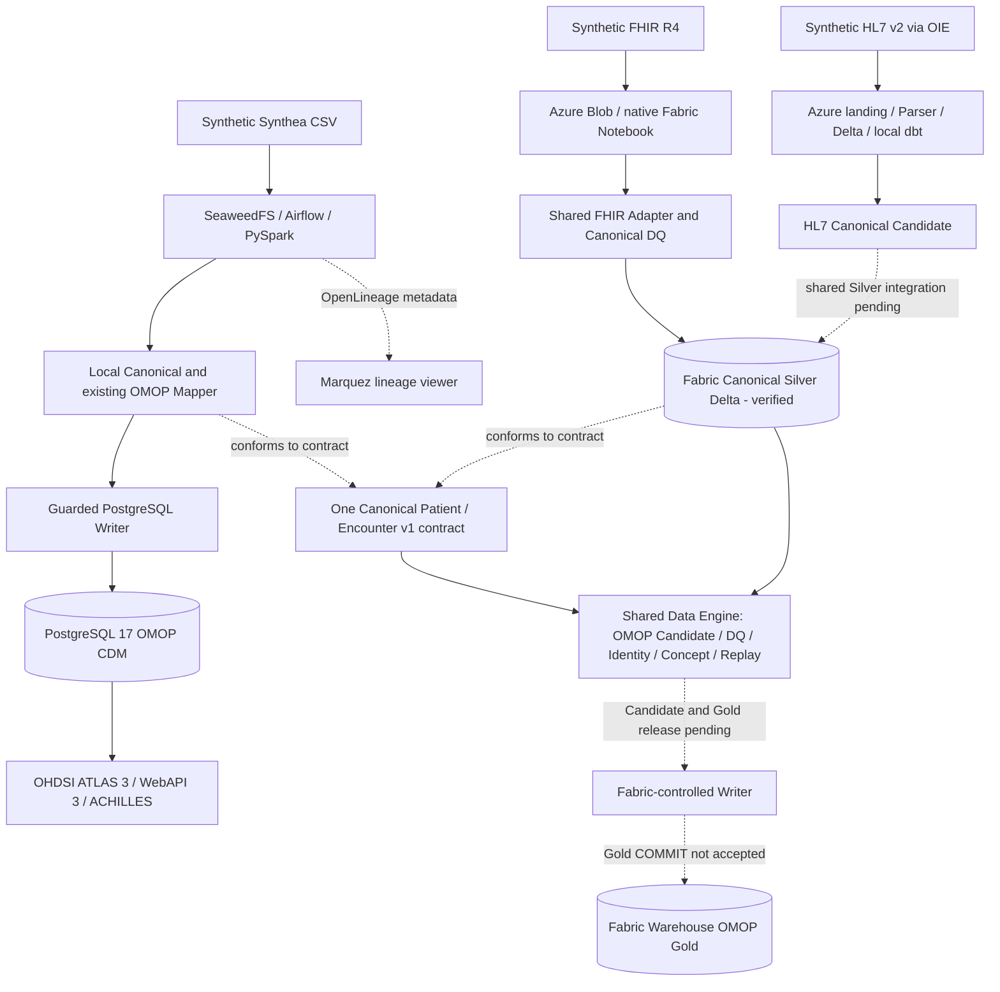

# Healthcare Data Platform

**Unified data platform engineering — source integration, Canonical standardization, reusable transformations, governed publication, lineage, and research analytics.**

A unified data platform is more than a set of ETL jobs. New source systems should be onboarded through repeatable contracts, and downstream users should receive data with known meaning, quality, provenance, and replay behavior. This independent project explores those problems using synthetic healthcare data and the same architectural patterns applicable to enterprise research and operational data platforms.

It combines **Synthea CSV, FHIR R4, and HL7 v2** source paths, a shared **Patient/Encounter Canonical model**, a portable **Shared Data Engine**, **Local Kubernetes/PostgreSQL**, **Microsoft Fabric/OneLake/Warehouse**, **OpenLineage/Marquez**, and **OHDSI ATLAS 3.0** for research consumption. Not every source-to-target path has reached the same acceptance milestone; the sections below explicitly separate implemented capabilities from planned integrations.

**Explore:** [Live lineage viewer](https://lineage.johnzhang-dataforge.site) · [OHDSI ATLAS 3 research UI](https://atlas.johnzhang-dataforge.site/atlas/) (authenticated; demo-user browser acceptance in progress) · [Data-flow architecture](documents/architecture/DATA-FLOW.md)

> **Scope:** An independent, synthetic-data portfolio project. It is not affiliated with Emory University or Emory Healthcare, is not connected to a hospital production EHR, and makes no HIPAA-certification or production-SLA claim.

## Browse the repository (human-first)

The source tree is organized by **system and function**, not by development task number. [Full directory guide and legacy migration status](documents/engineering/development/REPOSITORY-STRUCTURE-AND-HUMAN-NAVIGATION.md).

| Folder | What you find there | Human-readable map |
| --- | --- | --- |
| [`local-data-platform/`](local-data-platform/) | Local Synthea, Airflow, Spark, PostgreSQL OMOP and OHDSI ATLAS/WebAPI; some legacy paths remain active | [Local components](documents/systems/data-platform/README.md) · [ATLAS](documents/systems/data-platform/atlas/CODE.md) |
| [`azure-fabric/`](azure-fabric/) | Fabric-native Items, Writer business code, deployment SQL/config and Terraform | [Fabric components](documents/systems/azure-fabric/README.md) |
| [`platform-portal/`](platform-portal/) | Marquez, OpenLineage, public viewer and metadata storage | [Portal components](documents/systems/platform-portal/README.md) |
| [`shared-data-engine/`](shared-data-engine/) | Platform-neutral Python Wheel for FHIR/Canonical, OMOP Candidate rules, Concept/Identity/FK validation, reconciliation and replay planning | [Shared Engine](documents/systems/data-platform/shared-engine/README.md) · [Code map](documents/systems/data-platform/shared-engine/CODE.md) |
| [`documents/`](documents/) | Canonical architecture, component README/CODE and runbooks | [Docs index](documents/README.md) |
| [`openspec/`](openspec/) | Adopted specs, active changes, archived accepted history | [Change lifecycle](documents/engineering/development/OPENSPEC-DEVELOPMENT-LIFECYCLE.md) |
| [`.github/`](.github/) | Workflows and centralized quality/test assets | [Developer CODE map](documents/engineering/development/CODE.md) |

The Local DP task-named directories are **operational compatibility paths**, not preferred new source organization. They are being assessed by function and consumer dependency before any physical migration. New code uses descriptive component names.

## The platform problem

A unified data platform should onboard a new source without reinventing an end-to-end pipeline. But a shared ingestion framework also cannot assume that CSV, FHIR, HL7, and future enterprise feeds have the same structure or semantics.

I designed the pipeline around a few practical questions:

| Engineering question | Design response |
| --- | --- |
| **How do we onboard another source?** | Separate format-specific producers/adapters from a common landing, batch identity, validation, and processing contract. |
| **How do different source records become consistent?** | Normalize source records into a canonical clinical representation, then map them to domain-standard OMOP tables while retaining source references. |
| **How do we know a load is trustworthy?** | Require explicit batch selection, validation, reconciliation, and database readback rather than trusting an orchestrator's green status. |
| **What happens after a failed or repeated run?** | Use batch identity, guarded commits, completion tracking, and a tested same-batch skip path to avoid duplicate writes. |
| **Can someone explain a number or field later?** | Capture job, dataset, run, and column lineage with OpenLineage and Marquez. |

The reusable part is **source onboarding, provenance, validation, reconciliation, and observability**. OMOP is the target model for this *clinical* example—not a universal model for HR, finance, student, or research administration data. Other domains would reuse the platform patterns with their own models and business rules.

## Canonical-first design and the Shared Data Engine

The core pattern is **source-specific adapter → single Canonical Patient/Encounter v1 contract → reusable business rules → platform-specific publishing → analytics/research consumption**.

- **Source onboarding:** CSV, FHIR R4 and HL7 v2 retain their format-specific ingestion, source identifiers, immutable manifests and batch provenance. HL7 follows OIE ADT A01/A03 → Azure Blob → Python Parser → local Delta → dbt; it does **not** require conversion through FHIR.
- **Canonical Silver:** One frozen Patient/Encounter v1 contract standardizes field semantics and identity references. Fabric FHIR Approved Silver Delta has independent physical readback; the HL7 shared Silver publisher is not yet accepted.
- **Shared business processing:** `healthcare_data_engine` is the *single* portable Python implementation for FHIR adaptation, Canonical DQ, OMOP Person/Visit Candidate mapping, versioned Concept profiles, identity/FK preflight, reconciliation and replay decisions. It never performs cloud, Delta or SQL writes itself.
- **Governed publication:** A Local PostgreSQL Writer and Fabric Warehouse Writer implement different physical transaction mechanisms. They share business contracts, **not** writer SQL. Identity checks, DQ, stable source identity, access controls, replay protection and independent readback are release conditions.
- **Consumption and observability:** OHDSI ATLAS/WebAPI/ACHILLES provides clinical research access to the existing Local OMOP CDM; Airflow/Spark OpenLineage events flow to Marquez.

**Status as of November 12, 2026:** The [Shared Engine package metadata](shared-data-engine/pyproject.toml) declares source version **0.1.13**; its isolated Fabric Spark 4.1 source/transport test is recorded in [PR #911](https://github.com/JohnZhang-DataForge/healthcare-data-platform/pull/911). Fabric's existing GA Environment retains its separately validated **0.1.7** Wheel until a controlled promotion. The verified Local CSV-to-PostgreSQL pipeline still includes a historical Local mapper; the **full Local runtime has not been migrated to the shared Wheel**. Source-only and isolated tests do not constitute Fabric Stage Release, Candidate publication or Gold COMMIT.

This is a **domain-extensible unified data platform pattern**, not a claim that OMOP is suitable for every data domain. A finance, student, HR or research-administration workload would reuse ingestion, validation, governance and observability patterns with its own canonical/target models. See the [Medallion Canonical ADR](documents/architecture/design/FABRIC-MEDALLION-CANONICAL-ADR-20261030.md), [system architecture](documents/architecture/SYSTEM-OVERVIEW.md) and [Shared Engine ownership rules](documents/engineering/development/SHARED-DATA-ENGINE-STRUCTURE-AND-OWNERSHIP.md).

## Architecture: heterogeneous sources, consistent contracts

Solid arrows describe implemented component paths; the Local CSV → PostgreSQL → ATLAS and the FHIR Bronze/Canonical Silver segments have physical evidence. Dashed arrows identify shared contracts, observability metadata or unfinished publication paths. They are **not** evidence of a single deployed cross-source runtime or an already synchronized Local PG and Fabric Warehouse. For stage-by-stage acceptance see the [detailed data flow](documents/architecture/DATA-FLOW.md).

## What has been demonstrated

| Capability | Verified outcome and boundary |
| --- | --- |
| **Local end-to-end OMOP** | Synthea CSV → S3-compatible SeaweedFS → Airflow → PySpark → PostgreSQL OMOP Person/Visit; atomic guarded COMMIT, independent readback and same-batch replay SKIP. A historical October 25 batch committed **100 Person / 15,742 Visit** rows (batch-specific counts, not current totals). |
| **FHIR R4 → Canonical Silver** | Fabric synthetic FHIR Bronze and **100 Patient / 5,918 Encounter** Approved Silver Delta, zero quarantine, real readback and replay evidence. Clinical Gold remains uncommitted. |
| **HL7 v2 interoperability** | Synthetic ADT A01/A03 ingestion through OIE and Azure Blob with local Python Parser → Delta → dbt Canonical Candidate. Shared Fabric Silver and Gold are not yet accepted. |
| **Shared Data Engine** | Portable Python Wheel with FHIR Adapter, Canonical v1 validation, Person/Visit Candidate, Concept/Identity/FK checks, DQ, reconciliation and replay. **0.1.13** is current source; **0.1.7** remains deployed Fabric GA. Full Local replacement remains open. |
| **OHDSI research consumption** | ATLAS 3.0 + WebAPI 3.0 deployed on Kubernetes, registered `LOCAL_OMOP` Source/Daimons, verified Vocabulary access, ACHILLES reports, Concept Sets, Results schema, and native Cohorts (**1,394** and **1,207** distinct patient results). Demo browser access is still being checked. |
| **Lineage and operations** | Airflow/Spark OpenLineage → Marquez job/dataset relationships and Patient column mappings; Kubernetes, Terraform, GitHub Actions CI, immutable build/deployment contracts. Cross-platform Fabric business lineage remains a later acceptance scope. |

### OHDSI ATLAS 3.0 — research and analytics layer

ATLAS is a **downstream OMOP consumer** rather than another ETL engine. ATLAS 3/WebAPI 3 runs in the `dw-atlas` namespace on `worker03`, reuses existing PostgreSQL 17 `cdm` data, and maintains separate `webapi`, `atlas_results`, and `atlas_temp` schemas. Its `LOCAL_OMOP` Source exposes CDM and Vocabulary through a dedicated database identity without granting clinical source-table writes.

The integration includes WebAPI Source registration, authenticated dashboard endpoints, SQL-backed Concept/Vocabulary readback, Achilles data-source reports, initialized cohort tables, Concept Sets and native cohort-generation jobs. The research UI, demo-account permissions, indexed search performance, some downstream clinical domains and an isolated full restore drill are **not fully accepted**. Credentials and connection secrets are not stored in this README.

See [ATLAS code and acceptance map](documents/systems/data-platform/atlas/CODE.md) · [Kubernetes manifests](local-data-platform/kubernetes/manifests/atlas/) · [Source configuration](local-data-platform/atlas/config/local-omop-source.json).

### Inspect a transformation, not a slide

The live viewer shows the actual Synthea → canonical Patient lineage observed in the Spark pipeline. For example:

| Source field | Canonical field |
| --- | --- |
| `BIRTHDATE` | `birth_date` |
| `GENDER` | `gender_code` |
| `RACE` | `race_code` |
| `ETHNICITY` | `ethnicity_code` |
| `Id` | `source_record_id` |
| `DEATHDATE` | `death_date` |

**[Open the interactive lineage viewer](https://lineage.johnzhang-dataforge.site)** to explore the wider job/dataset relationships. It currently uses the native Marquez UI; a separate public-only UI build and fuller public access/security review remain open. These visualizations are evidence of observed business-level lineage, not a claim that every underlying Spark RDD lifecycle event is complete.

## How I would extend this to more sources

The goal is to keep the shared controls stable while allowing each source to have its own adapter and domain mapping.

1. **Define the source contract.** Record the producer/feed identity, format and schema expectations, batch identity, checksums, and source-to-target mapping rules.
2. **Land before transforming.** Keep the source payload and its metadata separate from normalized and curated datasets; detect missing or unexpected inputs before scheduling downstream work.
3. **Reuse the processing pattern.** Adapt FHIR resources or HL7 messages into an approved canonical representation, then apply domain-specific transformations and quality checks. The current end-to-end implementation covers the CSV-based clinical path.
4. **Publish only validated results.** Reconcile what was received and written, preserve source identifiers, and make reruns predictable.
5. **Make every handoff observable.** Carry dataset and run identity through orchestration and Spark, so investigators can trace unexpected output back to inputs and transformations.

This approach is deliberately not tied to one message standard or one processing runtime. It demonstrates a platform *pattern* using healthcare data, while leaving room for other business domains and their distinct models.

## Microsoft Fabric and governed data products

The Fabric foundation contains Blob landing, OneLake Lakehouse, Notebook/Pipeline/Environment assets and an OMOP 5.4 Warehouse/Vocabulary. The current verified clinical path reaches **FHIR → Bronze → Approved Canonical Silver**. A complete FHIR/HL7-to-Fabric **Candidate/Gold business COMMIT and replay E2E remains open**.

The G5 release direction replaces the historical two-person manual approval gate with **automated technical admission**: source integrity, schema/DQ, identity/FK and Concept validation, idempotent replay, security controls, authorized physical writes and independent readback. Removing the dual signature is **not** permission to skip these validations or to publish unaccepted Gold. An isolated 0.1.13 Spark/transport PASS does not authorize Stage Release or a Writer action.

Next milestones include HL7 Candidate → shared Canonical Silver, a consistent Shared Engine → Fabric Candidate path, independently verified Warehouse Gold transaction/replay, and gradual Local pure-function parity migration. Local PostgreSQL → Fabric analytical snapshot is a **separate future product**, not a prerequisite for Fabric-native FHIR ingestion. The authoritative task state lives in the [Fabric E2E OpenSpec](openspec/changes/fabric-fhir-omop-unified-e2e/tasks.md).

Only **synthetic records** are used. The platform is an engineering demonstration with carefully scoped runtime evidence, not a certified or always-on clinical production service.

## Explore the source code

These links go directly to implementation and build locations.

| Component | Source |
| --- | --- |
| Batch orchestration | [Airflow DAGs](local-data-platform/airflow/dags/) |
| Source onboarding, FHIR, and HL7 producers | [Clinical producer code](local-data-platform/apps/clinical_producers/) |
| Spark normalization and clinical mapping | [PySpark applications](local-data-platform/spark/apps/) |
| Reconciliation and controlled writes | [OMOP writer](local-data-platform/apps/omop_writer/) |
| Shared Canonical, OMOP Candidate and quality/identity rules | [Shared Data Engine source](shared-data-engine/src/healthcare_data_engine/) · [component map](documents/systems/data-platform/shared-engine/CODE.md) |
| HL7 Parser/Delta and dbt transformations | [HL7 component](documents/systems/data-platform/hl7/README.md) · [dbt project](azure-fabric/dbt/hl7-canonical/) |
| OHDSI ATLAS 3 / WebAPI 3 research layer | [ATLAS code map](documents/systems/data-platform/atlas/CODE.md) · [application configuration](local-data-platform/atlas/) |
| Input and output contracts | [Data contracts](local-data-platform/contracts/) |
| Kubernetes deployment definitions | [Kubernetes manifests](local-data-platform/kubernetes/manifests/) |
| Marquez integration | [Marquez component](platform-portal/marquez/) |
| Airflow/Spark lineage emitters | [OpenLineage integration](platform-portal/openlineage/) |
| Azure and Microsoft Fabric provisioning | [Terraform modules](azure-fabric/infra-terraform/) |
| Automated builds and checks | [GitHub Actions](.github/workflows/) |

## Copyright and usage restrictions

**Copyright © 2026 JohnZhang-DataForge. All rights reserved.**

This is an independent portfolio and demonstration project, **not an open-source project**. Unless expressly stated otherwise for third-party material, no license or permission is granted to use, copy, modify, distribute, sublicense, or create derivative works from this repository's code, documentation, configurations, or other original materials without the copyright holder's **prior written authorization**.

**Please do not fork, mirror, or copy this repository for reuse or independent development without prior written permission.** GitHub's Terms of Service may permit viewing and platform-native forking of public repositories; those platform permissions do **not** grant additional rights to use, modify, redistribute, or commercially exploit the project.

For permission requests, contact the repository owner.

---

*Independent unified healthcare data platform project · Synthetic data · Verified Local OMOP and OHDSI research flows · Canonical-first multi-source and Fabric Gold integration in progress.*
