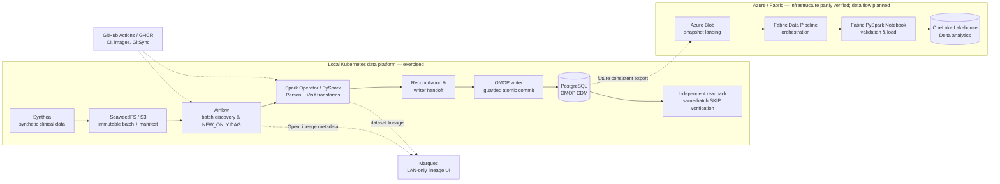

# Healthcare Data Platform

**A Kubernetes-native clinical data engineering lab, built to demonstrate reliable batch processing, infrastructure automation, and a practical path to hybrid-cloud analytics.**

**Stack:** Kubernetes · Python · PySpark · Apache Airflow · Spark Operator · SeaweedFS / S3 · PostgreSQL / OMOP CDM · OpenLineage / Marquez · GitHub Actions / GHCR · Terraform · Azure / Microsoft Fabric

> **What is real?** The local **synthetic-data → S3 → Airflow → Spark → PostgreSQL OMOP** pipeline has passed end-to-end batch execution, independent database readback, and same-batch replay/skip checks. A **LAN-only Marquez lineage viewer** has been exercised with real processing datasets and column-level lineage. **Azure/Fabric infrastructure and a Blob connection have been provisioned and verified**, but the full PostgreSQL → Fabric analytical data pipeline is **not yet an accepted end-to-end workload**.  
> This is a **hands-on engineering lab using synthetic patient data**, not a production healthcare system or a claim to handle real patient records.

**Explore:** [Architecture](#architecture) · [Engineering highlights](#engineering-highlights) · [Verified evidence](#verified-evidence) · [Technology and code](#technology-and-code) · [Current scope](#current-scope-and-roadmap) · [Documentation](#documentation)

## Why I built this

I use this repository to explore the engineering problems behind an end-to-end data platform, not just individual notebooks or sample ETL scripts:

- **Infrastructure & platform engineering:** deploying and connecting stateful and distributed services on Kubernetes.
- **Data engineering:** converting synthetic clinical source records into standardized OMOP CDM tables using PySpark and PostgreSQL.
- **Reliability:** making each batch identifiable, validated, recoverable, and safe to retry without duplicating committed data.
- **Automation:** building and publishing container images, syncing DAGs, running regression gates, and retaining reproducible evidence.
- **Observability:** connecting orchestration and Spark execution to real dataset lineage.
- **Hybrid-cloud design:** managing Azure/Fabric control-plane resources with Terraform while keeping actual ETL completion separate from infrastructure provisioning.

The key design choice is **producer–consumer decoupling**. A Synthea producer publishes a validated, immutable batch to object storage; Airflow discovers and processes the specific approved batch rather than implicitly generating new data. The OMOP writer commits only after validation and reconciliation, and previously completed batches follow a **no-replay** path.

## Architecture

The **solid path** below is the validated local batch architecture. The **dashed Azure path** is the intended analytical extension; it is **not presented as a completed cloud data flow**.

**Two different landings:** SeaweedFS is the *currently exercised Synthea source-batch landing*; Azure Blob is the *intended destination for a future consistent OMOP export*. They do not represent two already-operating halves of one cloud ETL pipeline.

## Engineering highlights

| Engineering concern | What the implementation demonstrates |
| --- | --- |
| **Kubernetes operations** | Separate containerized responsibilities for generation, orchestration, Spark execution, storage, and the OMOP database; real-cluster validation rather than Dockerfile-only smoke tests. |
| **Batch contracts and data quality** | Source batch IDs, immutable manifest/checksums, explicit processing guards, Person/Visit mapping, reconciliation, and independent PostgreSQL readback. |
| **Transactional reliability** | A guarded OMOP writer, claim/checkpoint tracking, atomic commit, and a demonstrated **already-completed → SKIP** path that does not run Spark/Writer again. |
| **CI/CD & artifact traceability** | GitHub Actions, self-hosted runner workflows, versioned GHCR images, Airflow GitSync, component tests, and validation tied to commit/run/batch evidence. |
| **Data observability** | Airflow/Spark OpenLineage events correlated in Marquez, real Patient/Encounter dataset versions, and native **table- and column-level** lineage views on the internal network. |
| **Infrastructure as Code** | Terraform-managed Azure/Fabric building blocks, remote state, access/connection checks, and a clear separation between **control-plane deployment** and **actual business data movement**. |

### Design decisions worth discussing in an interview

**Why immutable batches?** A batch ID plus manifest/checksum ties processing to a specific input snapshot. This is essential when a failed workflow has to be investigated or retried.

**Why read back from PostgreSQL?** A green Airflow task or successful SparkApplication alone is not proof that a transactional write persisted. Durable readback and reconciliation provide independent evidence.

**Why distinguish BGP-style “the connection is up” from “the application works”?** The same operational principle applies here: a running Pod, successful DAG, healthy API, or Terraform Apply validates *one layer*, not end-to-end behavior.

**Why separate Fabric infrastructure from Fabric ETL?** Creating a workspace, Lakehouse, permission assignment, or connection validates provisioning and access. It does not prove that data was exported, transformed, loaded, and independently reconciled.

## Verified evidence

These are **dated lab acceptance results**, not continuously refreshed production metrics. Links include the original actions and follow-up verification; a failed orchestration wrapper is not silently relabeled successful.

| Scope | Evidence and bounded outcome |
| --- | --- |
| **Local pipeline regression after source cleanup — Oct 2026** | [Three new + two prior batch checks](https://github.com/JohnZhang-DataForge/Self-Runner/actions/runs/39690143421) and [two additional new batches](https://github.com/JohnZhang-DataForge/Self-Runner/actions/runs/39696437220): **five new batches**, totaling **500 Person and 73,355 Visit rows**, each with commit/readback and same-batch skip checks; two prior completed batches also remained unchanged on replay. |
| **Published workload images** | [Main image build and publish](https://github.com/JohnZhang-DataForge/healthcare-data-platform/actions/runs/39689622324): **8/8 clean-build workload images** passed the recorded publication gate. |
| **Real Portal-linked OMOP batch — Oct 25, 2026** | One new batch committed **100 Person and 15,742 Visit rows**. The [original run](https://github.com/JohnZhang-DataForge/Self-Runner/actions/runs/40208104106) ended **FAILURE after the database commit** because a post-commit evidence file was missing; independent [PG/Marquez readback](https://github.com/JohnZhang-DataForge/Self-Runner/actions/runs/40209504539) and [same-batch SKIP](https://github.com/JohnZhang-DataForge/Self-Runner/actions/runs/40209818676) subsequently passed without a second commit. |
| **Lineage visibility** | [LAN-only Marquez validation and showcase notes](documents/systems/platform-portal/marquez/SHOWCASE-RUNBOOK.md): the real Patient/Encounter datasets were inspected in the official UI at **table and column level**. This is a scoped **Design A** acceptance, not proof of a fully complete physical Spark RDD action graph. |
| **Azure/Fabric control plane — Oct 22, 2026** | Azure Blob permission [Apply](https://github.com/JohnZhang-DataForge/Self-Runner/actions/runs/39774912636) and [independent readback](https://github.com/JohnZhang-DataForge/Self-Runner/actions/runs/39775311388); Fabric Blob connection [Apply](https://github.com/JohnZhang-DataForge/Self-Runner/actions/runs/39775898394), [GET verification](https://github.com/JohnZhang-DataForge/Self-Runner/actions/runs/39777494344), and Terraform no-drift checks. **Notebook/Pipeline business data ingestion has not been accepted.** |

For a rolling status and task-by-task evidence, use [PROJECT-STATUS.md](documents/engineering/status/PROJECT-STATUS.md), not the dated snapshot above.

## Technology and code

| Area | Primary technologies | Start reading |
| --- | --- | --- |
| **Local application & batch pipeline** | Python, Synthea, SeaweedFS S3, Airflow, Spark Operator, PySpark, PostgreSQL, OMOP CDM | [Local platform components](documents/systems/data-platform/README.md) · [Actual code](local-data-platform/) |
| **Orchestration** | Airflow DAGs, batch discovery, explicit NEW_ONLY selection, GitSync | [Airflow code map](documents/systems/data-platform/airflow/CODE.md) · [Consumer DAG](local-data-platform/airflow/dags/new_only_omop_consumer.py) |
| **Transform & persistence** | Spark transformations, reconciliation, source-ID mapping, atomic PostgreSQL writer | [Spark code map](documents/systems/data-platform/spark/CODE.md) · [OMOP code map](documents/systems/data-platform/omop/CODE.md) |
| **Platform / observability** | Kubernetes, containers, OpenLineage, Marquez, PostgreSQL metadata store | [Platform Portal](documents/systems/platform-portal/README.md) · [Portal source](platform-portal/) |
| **CI/CD & quality** | GitHub Actions, GHCR, self-hosted execution, contract and regression tests, OpenSpec | [Workflows](.github/workflows/) · [Engineering documentation](documents/engineering/README.md) |
| **Azure / Fabric** | Terraform, Azure Blob, IAM, Fabric Workspace/Lakehouse/Connection, planned Pipelines/Notebooks | [Fabric code](azure-fabric/) · [Fabric system guide](documents/systems/azure-fabric/README.md) |

## Current scope and roadmap

| Status | Capability | Boundary |
| --- | --- | --- |
| **Exercised locally** | Synthea source batches → S3 → Airflow → Spark Person/Visit → PostgreSQL OMOP; independent replay protection | Synthetic data, controlled **NEW_ONLY** batch path, not all OMOP domains or production throughput. |
| **Accepted with known limits** | Local Airflow/Spark lineage + Marquez internal viewer | Native table/column dataset visualization demonstrated; physical RDD action terminal-event gap and an older `unknown` job forensic item remain deferred. |
| **Partially deployed / verified** | Azure/Fabric infrastructure, identity/permissions, Blob connection and Lakehouse | Control plane only; no claim of an accepted PostgreSQL → Blob → Fabric → Delta data-plane E2E. |
| **In design / development** | FHIR/HL7 multi-source ingestion, Open Integration Engine integration, consistent OMOP export, Fabric Notebook/Pipeline ETL, richer cross-platform lineage | These require their own implementation, tests, deployment authorization, and end-to-end evidence. |

This repo prioritizes **correctness over green dashboards**: incomplete features, historical failed runs, and known observability gaps remain visible in the detailed documentation rather than being counted as finished work.

## How to explore the project

For a quick technical discussion, I suggest this walkthrough:

1. **Architecture:** trace one clinical batch across [the data-platform components](documents/systems/data-platform/README.md).
2. **Orchestration:** open the [NEW_ONLY Airflow DAG](local-data-platform/airflow/dags/new_only_omop_consumer.py) and explain explicit batch selection versus discovery.
3. **Reliability:** follow batch fencing, reconciliation, [OMOP writer code navigation](documents/systems/data-platform/omop/CODE.md), and the independent readback/skip evidence above.
4. **Observability:** review the [Marquez showcase](documents/systems/platform-portal/marquez/SHOWCASE-RUNBOOK.md) and the distinction between actual dataset edges and remaining RDD lifecycle gaps.
5. **Cloud:** walk through the [Fabric Terraform architecture](documents/systems/azure-fabric/infra-terraform/ARCHITECTURE.md) and distinguish applied infrastructure from unfinished business ETL.

## Documentation

- **[System architecture](documents/architecture/SYSTEM-OVERVIEW.md)** and [data flow](documents/architecture/DATA-FLOW.md) — project-level design, including documented target-state boundaries.
- **[Documentation index](documents/README.md)** — component guides, decisions, operations, development standards.
- **[Current project status](documents/engineering/status/PROJECT-STATUS.md)** — changing scope, acceptance evidence, and next work.
- **[Agent entry](AGENTS.md)** — instructions for coding assistants and contributors; the root README is a human-facing overview, **not** the agent rule source.
- **[Safe operations](documents/engineering/operations/SAFE-OPERATIONS.md)** — required precautions before modifying shared infrastructure or persistent state.

---

*Independent synthetic-data engineering project. Validation claims are scoped to the linked runs, versions, and dates; this README intentionally does not equate a successful infrastructure deployment with a working cloud data pipeline.*
