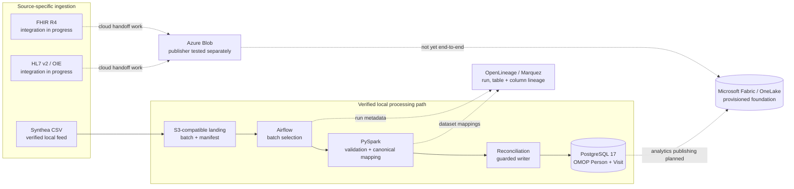

# Healthcare Data Platform

**A working vertical slice of a unified data platform — from source-specific ingestion to trusted, traceable data.**

Different systems rarely agree on schemas, identifiers, or delivery formats. The engineering challenge is not just moving their data into one place; it is preserving where it came from, applying consistent rules, detecting bad or incomplete loads, and making the results safe to reuse.

This independent project tackles those problems with synthetic healthcare data. It has a **verified local CSV-to-OMOP pipeline**, working Airflow/Spark lineage, and separately developing FHIR R4, HL7 v2, and Microsoft Fabric integrations. It is an engineering lab, not a hospital integration or a production EHR system.

> **[Explore the live data lineage viewer](https://lineage.johnzhang-dataforge.site)** — Inspect real Spark jobs, upstream/downstream datasets, and Patient field mappings in Marquez. The self-hosted demo may be temporarily unavailable.

## The platform problem

A new source system should not require a completely new pipeline. But a shared ingestion framework also cannot assume that CSV, FHIR, HL7, and future enterprise feeds have the same structure or semantics.

I designed the pipeline around a few practical questions:

| Engineering question | Design response |
| --- | --- |
| **How do we onboard another source?** | Separate format-specific producers/adapters from a common landing, batch identity, validation, and processing contract. |
| **How do different source records become consistent?** | Normalize source records into a canonical clinical representation, then map them to domain-standard OMOP tables while retaining source references. |
| **How do we know a load is trustworthy?** | Require explicit batch selection, validation, reconciliation, and database readback rather than trusting an orchestrator's green status. |
| **What happens after a failed or repeated run?** | Use batch identity, guarded commits, completion tracking, and a tested same-batch skip path to avoid duplicate writes. |
| **Can someone explain a number or field later?** | Capture job, dataset, run, and column lineage with OpenLineage and Marquez. |

The reusable part is **source onboarding, provenance, validation, reconciliation, and observability**. OMOP is the target model for this *clinical* example—not a universal model for HR, finance, student, or research administration data. Other domains would reuse the platform patterns with their own models and business rules.

## Architecture: different sources, common controls

**Reading the diagram:** The solid CSV → OMOP route has passed an end-to-end test and durable database readback. The OpenLineage connections are observed metadata flows. Dotted cloud integration routes are **component-level work or planned data flows**, not claims of a completed three-source Fabric pipeline.

Source producers, landing, processing, and publishing are separate responsibilities. A generated file does not authorize a database write: processing starts from a selected batch with known identity and validation evidence. This is the boundary that makes onboarding additional feeds practical without weakening the controls on existing ones.

## What has been demonstrated

| Capability | Verified result |
| --- | --- |
| **End-to-end clinical processing** | Synthea source data through S3-compatible landing, Airflow, PySpark, reconciliation, and OMOP **Person / Visit Occurrence** writes. |
| **Durable data quality checks** | A fresh October 25, 2026 batch committed **100 Person** and **15,742 Visit Occurrence** rows, confirmed by an independent PostgreSQL readback. |
| **Safe retries** | Reprocessing the same completed batch followed the skip path, with no further database changes. |
| **Real lineage** | The public Marquez UI has shown Patient and Encounter table-level paths, plus six real Patient column mappings. |
| **Repeatable infrastructure** | Kubernetes workloads, container builds, GitHub Actions checks, and Terraform-managed Azure/Fabric infrastructure. |

### Inspect a transformation, not a slide

The live viewer shows the actual Synthea → canonical Patient lineage observed in the Spark pipeline. For example:

| Source field | Canonical field |
| --- | --- |
| `BIRTHDATE` | `birth_date` |
| `GENDER` | `gender_code` |
| `RACE` | `race_code` |
| `ETHNICITY` | `ethnicity_code` |
| `Id` | `source_record_id` |
| `DEATHDATE` | `death_date` |

**[Open the interactive lineage viewer](https://lineage.johnzhang-dataforge.site)** to explore the wider job/dataset relationships. It currently uses the native Marquez UI; a separate public-only UI build and fuller public access/security review remain open. These visualizations are evidence of observed business-level lineage, not a claim that every underlying Spark RDD lifecycle event is complete.

## How I would extend this to more sources

The goal is to keep the shared controls stable while allowing each source to have its own adapter and domain mapping.

1. **Define the source contract.** Record the producer/feed identity, format and schema expectations, batch identity, checksums, and source-to-target mapping rules.
2. **Land before transforming.** Keep the source payload and its metadata separate from normalized and curated datasets; detect missing or unexpected inputs before scheduling downstream work.
3. **Reuse the processing pattern.** Adapt FHIR resources or HL7 messages into an approved canonical representation, then apply domain-specific transformations and quality checks. The current end-to-end implementation covers the CSV-based clinical path.
4. **Publish only validated results.** Reconcile what was received and written, preserve source identifiers, and make reruns predictable.
5. **Make every handoff observable.** Carry dataset and run identity through orchestration and Spark, so investigators can trace unexpected output back to inputs and transformations.

This approach is deliberately not tied to one message standard or one processing runtime. It demonstrates a platform *pattern* using healthcare data, while leaving room for other business domains and their distinct models.

## Microsoft Fabric and the next integration milestones

The Azure/Fabric foundation is provisioned with Terraform, including a Fabric workspace and OneLake Lakehouse. Azure Blob publishing has been exercised separately. **A complete FHIR/HL7 → Fabric Notebook/Pipeline → curated OneLake load has not yet passed end-to-end acceptance.**

The next milestones are to validate each additional feed against the same landing and reconciliation contracts, implement the Fabric ingestion/transformation path, and establish clear raw/normalized/curated data boundaries in the cloud. Data quality, lineage, replay behavior, and evidence of durable writes will remain acceptance criteria—not optional reporting features.

The project uses **synthetic records only**. It does not contain real patient data, and it makes no HIPAA certification, institution-wide production-readiness, or always-on availability claim.

## Explore the source code

These links go directly to implementation and build locations.

| Component | Source |
| --- | --- |
| Batch orchestration | [Airflow DAGs](local-data-platform/airflow/dags/) |
| Source onboarding, FHIR, and HL7 producers | [Clinical producer code](local-data-platform/apps/clinical_producers/) |
| Spark normalization and clinical mapping | [PySpark applications](local-data-platform/spark/apps/) |
| Reconciliation and controlled writes | [OMOP writer](local-data-platform/apps/omop_writer/) |
| Input and output contracts | [Data contracts](local-data-platform/contracts/) |
| Kubernetes deployment definitions | [Kubernetes manifests](local-data-platform/kubernetes/manifests/) |
| Marquez integration | [Marquez component](platform-portal/marquez/) |
| Airflow/Spark lineage emitters | [OpenLineage integration](platform-portal/openlineage/) |
| Azure and Microsoft Fabric provisioning | [Terraform modules](azure-fabric/infra-terraform/) |
| Automated builds and checks | [GitHub Actions](.github/workflows/) |

---

*Independent data engineering project · Synthetic clinical data · Verified local processing, with multi-source and Fabric ingestion under development.*
