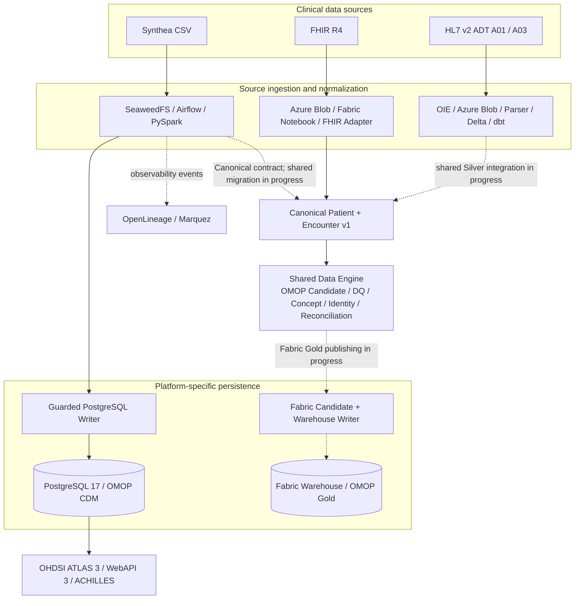

# Healthcare Unified Data Platform

**Turning heterogeneous healthcare data into consistent, governed, analytics-ready datasets.**

A hands-on platform engineering project that brings together clinical data integration, distributed processing, standardized data models, cloud analytics, and research workflows. I designed and built this independent platform to demonstrate how a **Unified Data Platform** can onboard different sources, reuse common business logic, and publish trustworthy data without rebuilding a separate pipeline for every format or destination.

Built with **synthetic healthcare data**, the platform integrates CSV, FHIR R4, and HL7 v2, applies a shared Patient/Encounter Canonical model, supports OMOP CDM 5.4, and connects data engineering workflows with Microsoft Fabric, OpenLineage/Marquez, and OHDSI ATLAS.

## What makes this platform different

| Platform capability | Engineering value |
| --- | --- |
| **Multi-source integration** | Onboard batch CSV, FHIR R4 resources, and HL7 v2 ADT messages through format-specific adapters and verifiable landing contracts. |
| **Canonical-first architecture** | Standardize source-specific clinical representations into a common Patient/Encounter model before downstream domain mapping. |
| **Reusable Shared Data Engine** | Keep OMOP Candidate mapping, validation, Concept rules, identity/FK checks, reconciliation, and replay planning in a portable Python package. |
| **Hybrid execution** | Use Kubernetes, Airflow, PySpark, and PostgreSQL locally while developing cloud-native ingestion and analytics with Azure Blob, OneLake, Fabric Lakehouse, and Warehouse. |
| **Trust and traceability** | Combine source manifests, data quality, controlled commits, replay protection, independent readback, and OpenLineage metadata. |
| **Research-ready consumption** | Make standardized OMOP data available to OHDSI ATLAS 3.0/WebAPI 3.0 for vocabulary exploration, cohort definitions, and population-level analysis. |

## Platform architecture

**Architectural principle:** Each source has its own adapter, but all sources target the same Canonical contract and shared business rules. Physical writers remain platform-specific because PostgreSQL and Fabric Warehouse have different persistence and transaction mechanisms.

The diagram is a **platform blueprint with working components**, not a claim that all three source paths are already running through one production-ready shared runtime. The validated local CSV flow currently retains some legacy mapper logic; Fabric clinical Gold publication and HL7 shared Silver integration remain in progress.

## Engineering highlights

### 1. From raw clinical feeds to standardized data

The local pipeline combines immutable source manifests, an S3-compatible landing zone, Airflow orchestration, Spark transformations, and guarded PostgreSQL writes. FHIR R4 is normalized into the common Patient/Encounter contract in Fabric. For HL7 v2, a separate path uses OIE ADT messages followed by Python parsing, Delta staging, and dbt transformations—without introducing an unnecessary HL7-to-FHIR conversion step.

### 2. One Shared Data Engine, multiple execution environments

The `healthcare_data_engine` Python Wheel centralizes reusable, platform-neutral clinical processing: Canonical validation, OMOP Person/Visit Candidate mapping, source-specific Concept profiles, identity and foreign-key checks, reconciliation, and repeatable-run decisions.

This separation reduces duplicate business logic while leaving storage access, orchestration, and database transactions to the appropriate runtime. The current source package is version **0.1.13**, with isolated Fabric Spark validation; the existing Fabric environment retains its previously validated **0.1.7** package until controlled promotion. The local historical mapper has not yet been fully replaced.

### 3. Quality and recovery as part of the design

The platform emphasizes **idempotency, provenance, and independent verification**. It identifies batches and source versions explicitly, validates record relationships before publication, protects committed data from accidental replay, and verifies durable writes through database readback—not just successful task status.

OpenLineage and Marquez complement these controls by exposing observed Airflow/Spark job, dataset, and Patient field-level lineage.

### 4. Standardized data delivered to research tools

OHDSI ATLAS 3.0 and WebAPI 3.0 run on Kubernetes against the local OMOP PostgreSQL database. The integration includes a registered OMOP Source, Vocabulary access, ACHILLES analysis summaries, Concept Sets, and native cohort-generation workflows. ATLAS consumes the standardized data without replacing or bypassing the OMOP Writer.

## Demonstrated results

| Area | Validated milestone |
| --- | --- |
| **Local data processing** | A synthetic Synthea batch committed **100 Person** and **15,742 Visit Occurrence** rows into PostgreSQL, with independent readback and same-batch replay SKIP. |
| **FHIR standardization** | Fabric Canonical Silver physically verified **100 Patient** and **5,918 Encounter** rows, with zero quarantine in that accepted batch. |
| **Shared processing** | Portable engine includes FHIR/Canonical, OMOP Candidate, Concept/identity preflight, data quality, and replay/reconciliation logic, with isolated Spark compatibility testing. |
| **ATLAS research workflows** | Registered OMOP Source, working backend Vocabulary/Concept queries, ACHILLES results, and native cohort-generation results including cohorts of **1,394** and **1,207** distinct patients. |
| **Traceability** | Observed Airflow/Spark lineage in Marquez, including dataset relationships and Patient column mappings. |

These are **specific verified engineering milestones**, not current all-system row totals. Fabric clinical Candidate/Gold transactions, complete HL7 shared publication, and some ATLAS demo-browser functions are still being validated.

## Technology stack

**Data engineering:** Python, PySpark, Spark, Apache Airflow, dbt, Delta Lake, S3-compatible SeaweedFS

**Data models and interoperability:** FHIR R4, HL7 v2, OMOP CDM 5.4, Canonical Patient/Encounter, OHDSI ATLAS/WebAPI/ACHILLES

**Cloud and data storage:** Microsoft Fabric, OneLake, Lakehouse, Warehouse, Azure Blob Storage, PostgreSQL

**Platform engineering and governance:** Kubernetes, Docker, Terraform, GitHub Actions, OpenLineage, Marquez, source manifests, data quality and idempotent processing

## Explore the implementation

The following links lead **directly to source-code directories** rather than design notes or internal project-management documents.

| Area | Source |
| --- | --- |
| Shared clinical transformations | [Shared Data Engine](shared-data-engine/src/healthcare_data_engine/) |
| Local ingestion and batch orchestration | [Airflow DAGs](local-data-platform/airflow/dags/) · [Clinical producers](local-data-platform/apps/clinical_producers/) |
| Spark transformations and OMOP publishing | [Spark applications](local-data-platform/spark/apps/) · [PostgreSQL OMOP Writer](local-data-platform/apps/omop_writer/) |
| HL7 standardization | [HL7 Parser/Delta](local-data-platform/spark/apps/hl7/) · [dbt Canonical](azure-fabric/dbt/hl7-canonical/) |
| Azure and Fabric implementation | [Fabric platform code](azure-fabric/) · [Infrastructure as Code](azure-fabric/infra-terraform/) |
| OHDSI ATLAS research layer | [ATLAS application](local-data-platform/atlas/) · [ATLAS Kubernetes deployments](local-data-platform/kubernetes/manifests/atlas/) |
| Lineage and observability | [OpenLineage](platform-portal/openlineage/) · [Marquez](platform-portal/marquez/) |
| CI and automated validation | [GitHub Actions workflows](.github/workflows/) |

## Project scope

This is an **independent portfolio and engineering demonstration**, developed using synthetic clinical records rather than actual patient data. It is not affiliated with a healthcare institution, connected to a live hospital EHR, certified for HIPAA compliance, or presented as an always-on production clinical service.

The objective is to demonstrate the architecture and engineering of a unified data platform: **ingest once, standardize consistently, reuse shared processing rules, publish under controls, and make data explainable and useful downstream.**

## Copyright and usage restrictions

**Copyright © 2026 JohnZhang-DataForge. All rights reserved.**

This is an independent portfolio and demonstration project, **not an open-source project**. Unless expressly stated otherwise for third-party material, no license or permission is granted to use, copy, modify, distribute, sublicense, or create derivative works from this repository's code, documentation, configurations, or other original materials without the copyright holder's **prior written authorization**.

**Please do not fork, mirror, or copy this repository for reuse or independent development without prior written permission.** GitHub's Terms of Service may permit viewing and platform-native forking of public repositories; those platform permissions do **not** grant additional rights to use, modify, redistribute, or commercially exploit the project.

For permission requests, contact the repository owner.

---

*Independent data platform engineering · Healthcare interoperability · Reusable processing · Microsoft Fabric · OMOP research analytics.*
