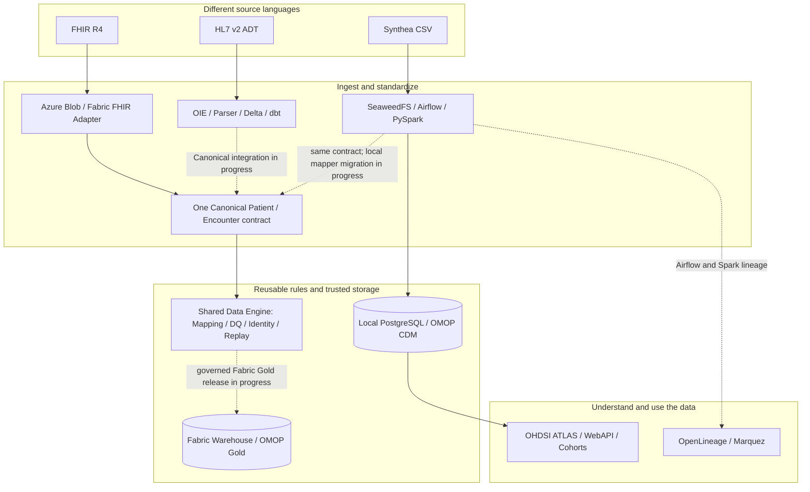

# Healthcare Data Platform

**Putting data in one place doesn't make it a unified data platform. Making that data work together does.**

## A question that should have an easy answer

Imagine a researcher asking:

> "How many patients had an emergency or inpatient visit? Can I explore that group and understand where the numbers came from?"

It sounds like a straightforward report. But the data team knows what comes next.

One system delivers CSV extracts. Another exposes FHIR resources. Hospital admission and discharge events arrive as HL7 messages. Each describes part of the same world, but in a different format, with different identifiers, fields, and assumptions. A record may arrive late. Yesterday's file may be sent again. Two systems may use the word *visit* differently.

Moving all those files into a central lake solves the storage problem. **It doesn't automatically solve the meaning, trust, or access problem.**

Before someone can build a useful dashboard, the team still has to ask: Which records belong together? What does each field mean? Did we load everything? Did a retry create duplicates? Can we trace the final number back to its source?

And when a new department or source comes along, will we have to build yet another custom pipeline?

**That is the problem I built this project to explore.**

## My approach: make the center useful, not just central

I built a small but working healthcare data platform using **synthetic data**. The goal isn't to put every integration tool in one repository. It's to show how different sources can enter a common data foundation, follow consistent rules, and become something researchers can actually use.

The design is built around four practical ideas.

### 1. Let each source speak its own language at the edge

A CSV export, a FHIR Patient resource, and an HL7 admission message shouldn't need identical ingestion code. Each gets the adapter and landing process appropriate to its format, while preserving source identity and enough evidence to trace or replay a batch.

In this project, the local CSV path uses SeaweedFS, Airflow, and PySpark. The FHIR path uses Azure Blob and Microsoft Fabric. The HL7 path uses OIE ADT messages, Python parsing, Delta staging, and dbt. The HL7 path goes straight toward Canonical data; it isn't needlessly converted into FHIR first.

### 2. Agree on meaning before trying to combine everything

The real turning point is a **shared Canonical Patient/Encounter contract**. Source-specific fields are translated into a consistent representation before downstream clinical mapping.

That is where the **Shared Data Engine** fits in. Instead of copying the same rules into every new pipeline, the portable Python engine brings together reusable Canonical validation, OMOP Person/Visit Candidate mapping, Concept checks, identity and foreign-key preflight, reconciliation, and replay decisions.

The benefit is simple: **a new source should need a new adapter, not a new business engine**. Local PostgreSQL and Fabric Warehouse can still have different writers without duplicating the underlying data rules.

### 3. Don't call it finished just because the pipeline is green

A successful workflow isn't proof that the data is right.

I designed the platform to keep track of what arrived, what was transformed, and what was actually committed. That means immutable manifests, batch identity, data-quality and relationship checks, guarded writes, independent database readback, and safe behavior when the same batch runs twice.

OpenLineage and Marquez make that work easier to investigate. If a number looks wrong, a data engineer should be able to follow it upstream rather than guess which job produced it.

### 4. Give the data somewhere useful to go

A unified platform isn't finished when the last table is populated. Someone still needs to **find, query, understand, and analyze** those tables.

That's why I added **OHDSI ATLAS 3.0 and WebAPI 3.0** on Kubernetes as a research-facing layer over the local OMOP database. The project goes beyond ingestion: it demonstrates Vocabulary lookup, Concept Sets, population-level summaries, and cohort generation from standardized synthetic clinical data.

ATLAS is the consumer, not another ETL pipeline. The same standardized data can support different questions without rebuilding the entire ingestion path.

## From source systems to answers

**A note on what's real today:** The local CSV-to-OMOP path has verified database commits and replay behavior. The FHIR path has verified persisted Canonical Silver data in Fabric. HL7 processing and the Shared Data Engine have working components, but the final multi-source Shared Engine-to-Fabric Gold path has not yet passed end-to-end acceptance. The diagram shows the intended common architecture without pretending every arrow is already in production.

## What I've actually demonstrated

The most useful proof isn't the architecture diagram. It's what happens when the system runs.

| A real engineering question | What the project has demonstrated |
| --- | --- |
| **Can we reliably land and process a batch?** | A Synthea CSV batch produced **100 Person** and **15,742 Visit Occurrence** OMOP rows in PostgreSQL, verified by an independent SQL readback. |
| **What if we run the same batch again?** | The completed-batch replay followed a **SKIP** path without changing committed rows. |
| **Can a different format use the same definitions?** | Synthetic FHIR R4 data produced **100 Patient** and **5,918 Encounter** records in verified Fabric Canonical Silver, with zero quarantine for that batch. |
| **Can the processing rules be reused?** | The Shared Data Engine implements portable validation, mapping, identity/FK checks and reconciliation logic, with isolated runtime compatibility tests. Full local mapper migration is still in progress. |
| **Can someone actually analyze the standardized data?** | ATLAS/WebAPI supports real backend Vocabulary and Concept Set workflows, plus verified synthetic cohorts of **1,394** and **1,207** distinct patients. Some demo-browser behavior is still being refined. |
| **Can we explain how a field got there?** | Marquez has displayed real Airflow/Spark dataset lineage and six Patient field mappings from source to Canonical data. |

These are **observed results from specific synthetic test runs**, not live hospital counts or a claim of full production deployment.

## Why this matters beyond healthcare

Consider a university bringing together academic records, HR data, research datasets, campus services, and clinical feeds. The formats, owners, and access rules differ. A central repository is only the starting point.

The repeatable part of this project is the **platform pattern**: onboard each source with clear contracts, translate it into shared business meaning, validate and trace the data, publish it safely, and give people a practical way to use it.

Here, **OMOP CDM 5.4** provides the standard model for the healthcare example. Other university or enterprise domains would need their own models and rules—not a forced conversion into OMOP. The same principles of source onboarding, canonicalization, governance, and analytics still apply.

My aim is a platform where adding the next source becomes routine, and answering the next research question becomes easier.

## Explore the implementation

If you're interested in how I approached a particular piece, these links go **directly to source-code directories**.

| Part of the story | Implementation |
| --- | --- |
| Common processing and clinical mapping | [Shared Data Engine](shared-data-engine/src/healthcare_data_engine/) |
| Source onboarding and scheduled processing | [Clinical producers](local-data-platform/apps/clinical_producers/) · [Airflow DAGs](local-data-platform/airflow/dags/) |
| Local normalization and guarded commits | [Spark applications](local-data-platform/spark/apps/) · [OMOP Writer](local-data-platform/apps/omop_writer/) |
| HL7 transformations | [HL7 processing](local-data-platform/spark/apps/hl7/) · [dbt models](azure-fabric/dbt/hl7-canonical/) |
| Microsoft Fabric and infrastructure | [Fabric implementation](azure-fabric/) · [Terraform](azure-fabric/infra-terraform/) |
| Research and cohort analysis | [ATLAS integration](local-data-platform/atlas/) · [Kubernetes deployments](local-data-platform/kubernetes/manifests/atlas/) |
| Traceability | [OpenLineage integration](platform-portal/openlineage/) · [Marquez](platform-portal/marquez/) |
| Automated validation | [CI workflows](.github/workflows/) |

## Project scope

This is an **independent engineering portfolio project** built with synthetic healthcare records. It is not affiliated with a hospital or university, does not process real patient data, and does not claim HIPAA certification, a production EHR integration, or an always-on service SLA. Some cross-platform publication and research UI capabilities remain under development.

## Copyright and usage restrictions

**Copyright © 2026 JohnZhang-DataForge. All rights reserved.**

This is an independent portfolio and demonstration project, **not an open-source project**. Unless expressly stated otherwise for third-party material, no license or permission is granted to use, copy, modify, distribute, sublicense, or create derivative works from this repository's code, documentation, configurations, or other original materials without the copyright holder's **prior written authorization**.

**Please do not fork, mirror, or copy this repository for reuse or independent development without prior written permission.** GitHub's Terms of Service may permit viewing and platform-native forking of public repositories; those platform permissions do **not** grant additional rights to use, modify, redistribute, or commercially exploit the project.

For permission requests, contact the repository owner.

---

*One problem, many source systems, one shared data foundation — and a clearer path from raw data to useful answers.*
