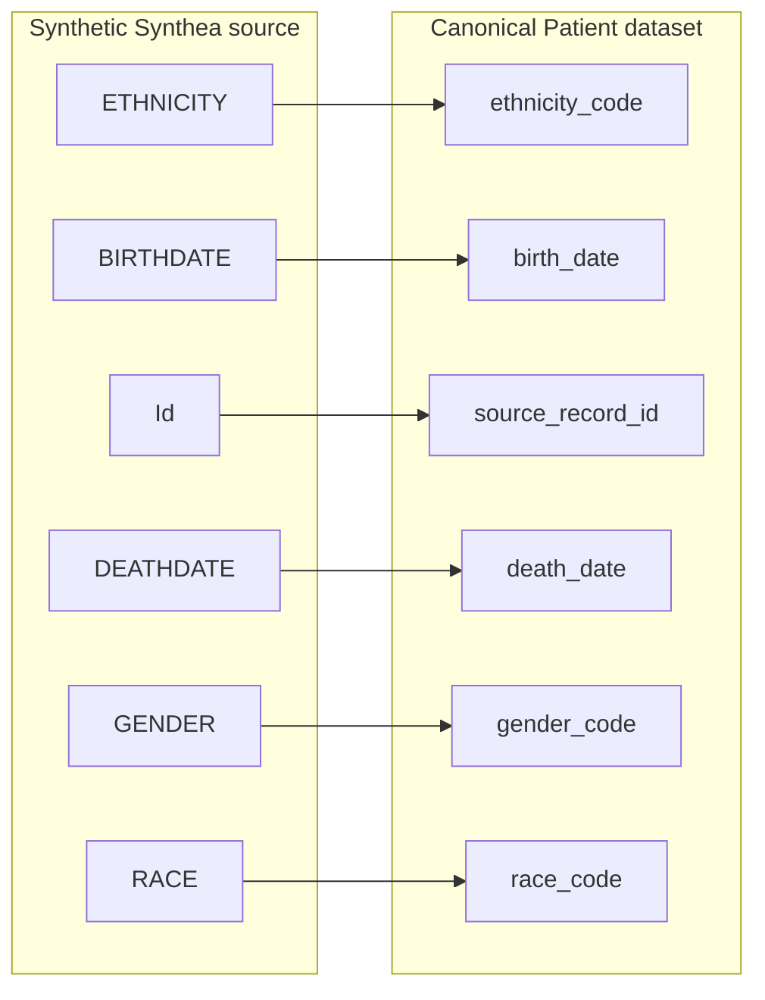
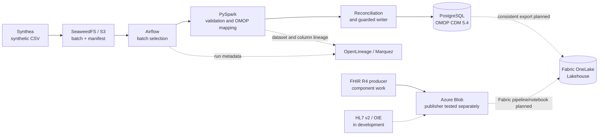

# Healthcare Data Platform

> **LIVE INTERACTIVE DEMO** — **[Explore the Healthcare Data Lineage Viewer](https://lineage.johnzhang-dataforge.site)**
>
> Explore real Airflow/Spark jobs, dataset dependencies, run metadata, and column-level transformations in Marquez. The pipeline uses **synthetic clinical data only**; this is a self-hosted engineering lab, so availability is not guaranteed.

### See the transformations at field level

These are six field mappings observed in the live Marquez Column Level view for the synthetic Patient pipeline.

A clinical data engineering project built with Kubernetes, PySpark, Apache Airflow, PostgreSQL, and Microsoft Fabric.

The project starts with a straightforward problem: clinical data arrives in different formats, while analysts need consistent, traceable records they can query. I built a working local pipeline that takes synthetic patient and encounter data from source files to **OMOP CDM 5.4** tables. I am extending it with FHIR/HL7 source integration and an Azure/Microsoft Fabric analytics layer.

This is an independent engineering project using **synthetic data only**. It is not connected to a hospital or a production EHR, and it does not contain patient information.

## The platform at a glance

| Layer | Technology | Responsibility |
| --- | --- | --- |
| Source and ingestion | Synthea, CSV; FHIR R4 and HL7 v2 adapters in development | Generate or receive clinical records; preserve source identity and batch metadata |
| Landing | SeaweedFS (S3-compatible); Azure Blob for cloud integration | Keep source batches and manifests separate from transformed data |
| Orchestration | Apache Airflow | Select approved batches, coordinate Spark jobs, handle retries and checkpoints |
| Processing | Apache Spark / PySpark, Python, SQL | Validate, normalize, map Patient/Encounter records to OMOP, and reconcile results |
| Clinical data store | PostgreSQL 17, OMOP CDM 5.4 | Persist standardized Person and Visit Occurrence records through a guarded writer |
| Lineage | OpenLineage, Marquez, PostgreSQL 14 | Track DAG runs, Spark jobs, datasets, and column mappings |
| Cloud analytics | Azure Blob, Microsoft Fabric, OneLake Lakehouse | Provisioned foundation; end-to-end analytical ingestion is still in development |
| Delivery | Kubernetes, Terraform, GitHub Actions, GHCR | Build images, provision infrastructure, run checks, and keep changes reproducible |

### Data flow

The solid path is the local pipeline that has been exercised end to end. Dashed paths show work that is not yet accepted as a complete data flow.

The local components run on a multi-node Kubernetes cluster. The producer and consumer are separate: generating a file does not automatically authorize a database write. A batch is identified by its manifest and checksum, and the consumer processes an approved snapshot rather than whatever happens to be newest in storage.

## What is working

**A real Person/Visit pipeline.** Synthea publishes synthetic source batches to S3-compatible storage. Airflow runs PySpark transformations for Patient and Encounter records, maps them to OMOP **Person** and **Visit Occurrence**, checks the resulting data, and hands it to a controlled PostgreSQL writer. Source IDs and batch IDs remain available for traceability.

**Retry-safe database writes.** The pipeline checks batch identity and prior completion before committing. Reconciliation and database readback are separate from orchestration status: a successful Airflow task does not, by itself, prove the data was committed. Running an already-completed batch follows a skip path rather than inserting the same records again.

**Run and data lineage.** Airflow and Spark emit OpenLineage metadata to Marquez. The [public lineage explorer](https://lineage.johnzhang-dataforge.site) has been opened in a browser showing real Patient and Encounter table-level lineage and Patient column mappings. It reuses the native Marquez UI behind a method-filtering gateway; a dedicated public-facing UI and broader security review remain future work. An unresolved Spark RDD action lifecycle gap does not prevent viewing the verified business-level dependencies.

**Repeatable engineering work.** Components are packaged as containers and deployed on Kubernetes. GitHub Actions builds and tests the images, while Terraform manages the Azure/Fabric infrastructure. Code, contracts, workflow definitions, and operational notes are kept in the repository.

### A verified batch

On October 25, 2026, a new synthetic batch committed **100 Person** and **15,742 Visit Occurrence** rows. Independent PostgreSQL readback confirmed the commit, and a repeat run took the already-completed-batch skip path without further database changes. These are results from specific test runs, not production availability or performance claims.

## Design choices

### Standardize the clinical model, not just the file format

CSV, FHIR, and HL7 have different structures and identifiers. The target is a consistent OMOP model that keeps source references and supports SQL-based analysis. The current accepted mappings cover **Person** and **Visit Occurrence**; the remaining OMOP domains and the complete multi-source ingestion path are future work.

### Check data after it lands

Schema checks, manifests, source-to-target reconciliation, and durable readback answer different questions. Keeping those checks separate makes failures easier to isolate and prevents a green scheduler status from masking missing data.

### Preserve history and make retries predictable

Immutable source batches, explicit batch selection, guarded commits, and a completion ledger make a failed or repeated run easier to investigate. A retry should not silently change the identity of its source data or duplicate a prior commit.

### Keep security and governance in the design

This repository uses generated records, not PHI. It explores practices that matter in governed healthcare environments: separate service identities, controlled storage access, source metadata, lineage, and documented data contracts. It does **not** claim HIPAA certification or production security validation.

### Keep Fabric deployment separate from Fabric data ingestion

Terraform has provisioned and verified the Azure/Fabric foundation, including workspace, Lakehouse, identity/access configuration, and a Blob connection. Fabric pipelines/notebooks and the full **OMOP → Azure Blob → OneLake** analytical flow have **not** passed end-to-end acceptance. That work, along with FHIR/HL7 ingestion, is the next stage.

## Explore the source code

The links below go straight to the implementation and build files—no internal runbooks or agent-facing documentation.

| Area | Source |
| --- | --- |
| Airflow orchestration and batch consumer | [Airflow DAGs](local-data-platform/airflow/dags/) |
| Synthetic clinical producers, FHIR and HL7 integration | [Clinical producers](local-data-platform/apps/clinical_producers/) |
| PySpark Person/Visit transformations | [Spark applications](local-data-platform/spark/apps/) |
| Guarded and idempotent OMOP writing | [OMOP writer](local-data-platform/apps/omop_writer/) |
| Data contracts and validation | [Contracts](local-data-platform/contracts/) |
| Kubernetes application definitions | [Kubernetes manifests](local-data-platform/kubernetes/manifests/) |
| Marquez metadata and lineage setup | [Marquez integration](platform-portal/marquez/) |
| Airflow/Spark OpenLineage emitters | [OpenLineage integrations](platform-portal/openlineage/) |
| Azure / Microsoft Fabric infrastructure | [Terraform source](azure-fabric/infra-terraform/) |
| CI/CD image builds and checks | [GitHub Actions workflows](.github/workflows/) |

---

*Independent engineering project · Synthetic clinical data only · Local OMOP pipeline verified · Multi-source and Fabric analytics still in development.*
