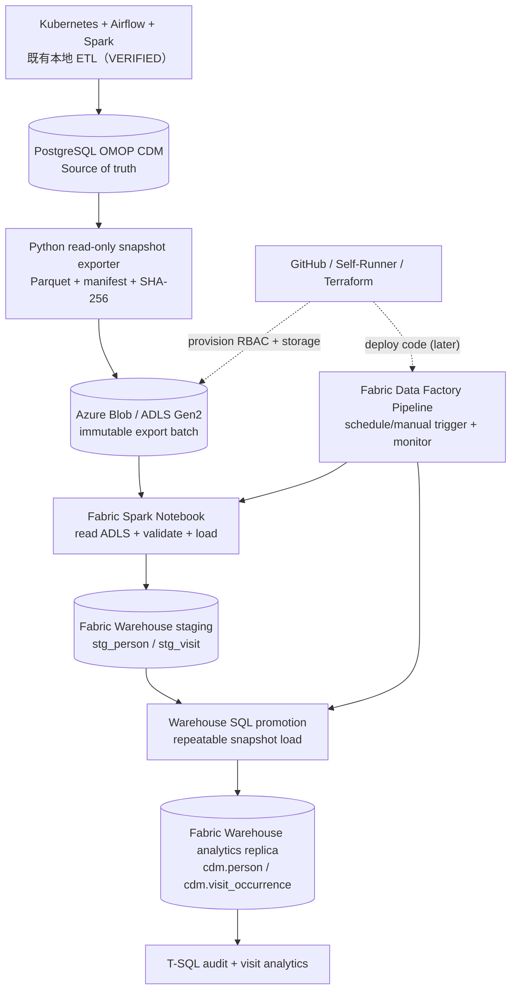

# Azure + Microsoft Fabric 最小实现方案（Healthcare Data Platform）

> **Status: DESIGN APPROVED FOR PLANNING / NOT DEPLOYED / NOT VERIFIED**
>
> Version: 1.0 · Date: 2026-10-14 (America/New_York) · Owner repo: `JohnZhang-DataForge/healthcare-data-platform`
>
> **本文件是新独立 Azure/Fabric 工作流的权威实施方案，不是 TASK004/TASK005 状态文件。** 后续 Azure 真实部署、执行、验证后方可把相应步骤更新为 VERIFIED。
>
> 开发入口：[文档导航](../README.md) · [当前 TASK 状态](../tasks/TASK-STATUS.md) · [已验收本地链路](../tasks/TASK-004-NEW-ONLY-E2E-FINAL-ACCEPTANCE-2026-10-14.zh-CN.md) · [原混合云远期架构](../architecture/Healthcare-ETL-Hybrid-Fabric-ML-Design.zh-CN.v2.1.md)。

## 1. 设计目标与决定

**目标：最少 Azure 成本和开发量，真实证明从已经验收的本地 OMOP PostgreSQL 到 Azure Storage、Fabric PySpark、Fabric Data Factory 和 Fabric Warehouse 的端到端运行能力。**

- **本地是主数据处理平台**：现有 Kubernetes、Synthea、SeaweedFS、Airflow、Spark Operator、PostgreSQL OMOP CDM 继续负责源文件、标准化、映射、入库、批次幂等与原始数据管理。
- **云端是轻量分析副本**：从已入库的 `cdm.person`、`cdm.visit_occurrence` 导出一致快照；不在 Fabric 重跑 FHIR/HL7/Synthea/完整 OMOP ETL。
- **第一版仅使用四类业务组件**：真实 Azure Blob/ADLS Gen2、Fabric PySpark Notebook、Fabric Data Factory Pipeline、Fabric Warehouse。可以有一个 Fabric Workspace / Trial Capacity，但**不强制新增 Lakehouse、云端 Airflow、Databricks、Synapse、dbt、MLflow、Power BI 或 Key Vault**。
- **Infrastructure as Code**：Azure Resource Group、业务 Storage、数据 Container、访问控制及 OIDC 采用 Terraform；Self-hosted GitHub Actions Runner 负责执行 Terraform。
- **Ephemeral Runner 不持久化 State**：Terraform State 位于**独立 Azure Blob Storage Account 的私有 `tfstate` Container**，不使用本地 `local-path` PVC，也不能推送到 Git。
- **安全优先于组件数量**：Entra ID + 最小权限 RBAC + GitHub OIDC，数据只允许 Synthea 合成数据；不使用任何真实患者或受监管医疗记录。
- **控制验收口径**：只有 Azure 实测后才能把 Fabric 能力写成已完成。此文档不改变本地 TASK004 已完成、TASK005 尚待实现的权威状态。

### 本地现有基线（不是 Azure 成功证据）

截至 2026-10-14 本地 TASK004 最终验收：PostgreSQL `cdm.person` **208** 行，`cdm.visit_occurrence` **21,934** 行，3 个 COMPLETED claims；同批 Airflow 重复运行已验证 SKIP。**云端不得把这些数字硬编码为未来预期值**，导出时以一致性快照及 Manifest 为准。现有 S3/SeaweedFS 不被替换、不向本地 OMOP 反向写入。

## 2. 最小业务架构



**数据方向单向**：本地 PG → 云端 Blob → Fabric Warehouse。Fabric 不直接对本地 PostgreSQL 开端口，不需要公网暴露本地 PG，也不需要安装新 Windows Data Gateway。

| Azure/Fabric 组件 | 做什么 | 第一版交付 |
| --- | --- | --- |
| Azure Storage Account（HNS enabled）| 真正的 Blob/ADLS Gen2 落地点 | 1 个 Storage Account、1 个私有数据 Container |
| Fabric Notebook（PySpark）| 读 Parquet、校验 Schema / PK / FK / 数量、写 Warehouse Staging | 1 个 Notebook |
| Fabric Data Factory | 编排、参数、重试、日志、Pipeline 状态 | 1 条 Pipeline（Notebook Activity + SQL Script/Stored Procedure Activity）|
| Fabric Warehouse | 保留选定 OMOP 表结构，执行 SQL 分析、审计与对账 | 1 个 Warehouse（含 `cdm`、`stg` 和简化 `audit` Schema）|

**Fabric Data Factory 不是数据库；Warehouse 不是调度器。** Data Factory 启动并监控 Notebook / 后续 SQL Activity；Spark 做数据处理；Warehouse 存数据并执行 T-SQL。第一版不需要 Data Factory Copy Activity，因为 Spark 已直接读 ADLS。

## 3. 第一版业务数据合同

**仅选择两张 OMOP 表：**

- `cdm.person`（主键 `person_id`）。
- `cdm.visit_occurrence`（主键 `visit_occurrence_id`，`person_id` 引用前表）。

### 3.1 本地导出

- 通过**只读 PostgreSQL 账号**在同一个一致性快照中读取两表，避免导出时间错位造成 FK 假失败；优先事务隔离 `REPEATABLE READ READ ONLY`。
- 将数据写成两份固定 Schema 的 Parquet。固定字段类型、UTC 时间规则和可空约束；在第一次实现前盘点 PostgreSQL 类型到 Spark / Warehouse 类型的映射，不将 PostgreSQL 约束视作 Fabric 已自动强制执行。
- 为每次导出分配不可变的 `export_id`，使用批次目录：`omop-export/export_id=<id>/person.parquet`、`visit_occurrence.parquet`，最后上传 `manifest.json`。
- Manifest 至少记录 `export_id`、`source_snapshot_at`、表名/行数、源 Schema 版本、文件 SHA-256、导出代码 Git SHA、是否 `READY`。上传和哈希回读全部成功**之后**才写入 READY Manifest。
- 导出属于本地源的**分析快照**，不会 Claim 新的 Synthea 批次，不重新运行 TASK004 Writer，不修改 PG/SeaweedFS 的历史数据。

### 3.2 云端 Data Factory + Notebook + Warehouse

1. 手动（后续可按需调度）执行 `pl_omop_snapshot_to_warehouse`，显式传入 `export_id` / Manifest URI。
2. Pipeline 检查 Manifest READY，调用 `nb_omop_snapshot_load`（Notebook Activity）；失败就停止，不启动后续 SQL。
3. Notebook 从 `abfss://<container>@<account>.dfs.core.windows.net/...` 读取 Parquet，验证 Manifest SHA/行数、空主键、主键重复、孤儿 Visit、预期字段、类型及 Manifest 的导出批次一致性。
4. Notebook 把合格数据写入 Fabric Warehouse **Staging**（例如 `stg.person_snapshot`、`stg.visit_snapshot`），写入时使用目标 Runtime 明确支持的 Fabric Spark Warehouse Connector。**必须确认当前 Notebook 是受支持的 Runtime（目前官方写入要求 GA Runtime 2.0）及目标 Warehouse 权限**。
5. Pipeline SQL Activity 在目标 Warehouse 执行受控的 snapshot promotion：先验证 Staging / Manifest，后事务性更新 `cdm.person` / `cdm.visit_occurrence` 与 `audit.pipeline_run`。使用**全量快照可重放覆盖**或受控 staging+MERGE，不采用纯 append；先验证实际 Warehouse SQL 语法/事务能力，再冻结实现。不要凭空宣称多表原子性。
6. 最后独立运行 SQL 读取目标表，核对 `person` 与 `visit_occurrence` 的行数、主键唯一、FK、样例分析结果；记下 Fabric Pipeline Run ID、Warehouse 查询结果及代码 SHA。

**先做全量一致快照，不宣称 CDC 或增量同步。** 将来需要 daily incremental 才另立阶段设计 reliable watermark/CDC/更新删除/晚到数据；当前“每日重传全量快照”不能写成“增量复制”。

### 3.3 验收用例

- **E2E**：从真实本地 `cdm` 读出、Azure 上传成功，Fabric Pipeline 运行成功，Warehouse 两表数量与对应 Export Manifest 一致。
- **DQ**：注入一个合成的重复 Person 或无效 Visit，Notebook fail closed，Warehouse 已验收数据不被污染。
- **Replay**：相同 `export_id` 重复执行，Warehouse 内容和行数不变，无额外业务重复行；审计记录保留两次运行事实。
- **Drift**：更换 `export_id` 的合法新快照，目标按约定替换或同步到最新；不得将旧快照覆盖更新快照，必须有时间/版本防倒退。
- **Failure recovery**：失败后可使用固定 Manifest 重新运行，不重新导出原始数据，不半途清空验收成功的目标。
- **Evidence**：保存脱敏日志、Manifest 哈希、Terraform Plan/Apply 结果、Pipeline Run ID、Notebook Run ID、SQL 只读验证、成本截图或计费明细。不得存储 Token/连接字符串/患者敏感信息。

## 4. Terraform 与 Self-Runner 分工

### 4.1 目录建议（创建前检查仓库实际布局）

```text
healthcare-data-platform/
  infra/azure/                # canonical Terraform (后续开发)
    versions.tf
    backend.tf
    providers.tf
    main.tf
    variables.tf
    outputs.tf
  azure-fabric/               # 后续业务代码可按需建立
    exporter/                 # PG read-only -> Parquet -> Azure
    notebooks/                # Fabric PySpark notebook definition
    pipelines/                # Fabric Data Factory definition
    warehouse/                # SQL DDL / promotion / tests
    tests/
  docs/azure-fabric/
    README.md
    AZURE-FABRIC-MINIMAL-IMPLEMENTATION-PLAN-v1.0.zh-CN.md
Self-Runner/
  .github/workflows/          # 复用已存在 executor；仅必要时增加 Terraform 专项 Workflow
```

**原则**：Healthcare Repo 是业务/IaC 正式源码仓；Self-Runner Repo 只有 Workflow 执行、受控参数、Policy 和 Artifact。**先检查现有执行器能否复用**，不为了增加 Terraform 而重建一套 Runner 平台。

### 4.2 State Remote Backend Bootstrap（独立一次性初始化）

**State 永不使用 Pod 本地磁盘或 Kubernetes `local-path` 持久化。**

1. 有人以适当权限在 Azure 门户或 Azure CLI 手动创建独立 `rg-hcdp-tfstate` / 私有 State Storage Account / `tfstate` Container（具体名称取决于订阅与全局唯一性）。
2. 启用必要的 Blob 版本控制/软删除和适当权限，State 与业务数据 Storage Account **分离**，防止 Demo `destroy` 删掉 Backend。
3. Entra Identity / GitHub OIDC bootstrap：建立工作流联合凭据。**要绑定真正运行 Workflow 的 `JohnZhang-DataForge/Self-Runner` 的 subject/ref/environment**，不是只绑定 Healthcare 仓库。实际 `sub` 必须在部署前从 GitHub OIDC 合约核对。
4. State 的读取/写入按容器级 Data Plane RBAC 单独授权；Azure 资源变更按对应 Resource Group 最小 Management Plane 权限授权。权限不足或过宽都不可跳过审批。
5. Terraform `azurerm` Remote Backend 使用 Entra/OIDC（`use_azuread_auth` / `use_oidc` 等配置依所固定的 Terraform、Provider、Backend 版本验证）；State 的 `key` 可取 `healthcare/azure-dev.tfstate`。
6. 为 State Account 设置管理保护、私有访问；不要在 GitHub Repo、日志和 Artifact 输出 State，因为 State 可能包含 Secret。

### 4.3 Azure 业务资源（Terraform 管）

- 开发专用 Resource Group（例如 `rg-hcdp-azure-dev`）。
- 业务用 Storage Account：`Standard LRS`、`HTTPS only`、`HNS enabled`、禁止公开 Blob Container，生命周期策略按需求设置；独立于 State Storage。
- 一个 private Container（例如 `omop-export`），权限：Exporter 写、Fabric 读。
- Entra ID 身份、Federated Credential、RBAC 及资源 Tags。若身份/角色配置不能在现有权限下 Terraform 执行，允许 **bootstrap 单独人工**，后续再纳入代码与追踪；不使用持久应用 Client Secret。
- Azure Key Vault **不作为 MVP 必备项**：Blob 默认静态加密；优先 Entra / RBAC / OIDC；有必须存储的第三方机密时再追加 Key Vault。Key Vault 不等于身份认证系统，也不是本例自带的 KMS 前置条件。

### 4.4 GitHub Actions / Ephemeral Runner

- GitHub Workflow 由 Self-Runner Repo 触发，ARC Ephemeral Pod 安装/使用版本固定的 Terraform、Azure CLI、providers；拉取固定 Healthcare Commit SHA。
- 身份使用 GitHub Actions OIDC：权限需含 `id-token: write`，Azure 信任限制到明确的仓库、分支/Environment。警惕受外部 PR 控制的 Workflow 代码在带 Azure 权限的 Runner 上执行。
- PR：只读 `terraform fmt -check`、`validate`、`plan`（若具备权限）；保持人工 Review / Gate。
- Apply：需要显式审批、锁定 SHA / State Key、记录 Plan 摘要与结果；**不因普通 PR 合并而自动 destroy 或 apply**。
- Destroy：只能手工、审批、二次核对目标订阅/Resource Group/State Key；Backend Storage 永不包含在业务 destroy 范围。
- Azure 配置更改必须可以在新的 Runner Pod 中从空环境复现，不能依赖宿主机 `/data` 或旧 Pod 缓存。

## 5. 身份、凭据与最低安全边界

| 调用方 | 建议方式 | 最小权限思路 |
| --- | --- | --- |
| Self-Runner Terraform | GitHub OIDC → Entra workload identity federation | Azure 业务 RG 的管理权限（Bootstrap 后收紧）+ State Container 的数据访问 |
| 本地导出 Python → Azure Data | 从 Self-Runner Workflow 执行时使用**独立** OIDC 身份（首版可逐步分离） | `Storage Blob Data Contributor`（限定业务 Container 或最小可行范围） |
| Fabric 读取 ADLS | 初次交互使用 Entra 用户登录；调度时配置支持的 Fabric Connection / 执行身份，并**实测 Notebook Activity 身份上下文** | `Storage Blob Data Reader`（限定业务存储范围） |
| Notebook → Fabric Warehouse | Fabric 原生 Warehouse/Workspace 权限 | 能写 `stg`、按约定执行受控 SQL；不授权 Workspace Admin 给一般 ETL |
| GitHub Workflow | Repo/Environment Policy + OIDC subject | 限定可信 Workflow、受控参数、固定 SHA |

**重要区别**：Fabric **Data Factory Connection** 支持 Workspace Identity 访问 ADLS，**不代表所有 Spark Notebook 的 `abfss` 读取就自动继承该身份**。Notebook 的交互/管道执行实际身份和凭据传递方式必须在 STEP03 单独验证。不得把账号密码/Storage Key/SAS 直接写到 Notebook 或公开 Repo；确需临时 Secret 时不得输出内容并设置到期时间。

**只使用 Synthea 合成数据。** 本 Demo 可展示医疗数据治理的技术设计，但不代表生产环境已获 HIPAA 认证；未来引入真实 PHI 前须按组织合规流程审查授权、隔离、日志/保留及数据传输策略。

## 6. Fabric 试用、成本和启停

- 初期用 Fabric Trial Capacity（实际授予规格依租户而定）完成联调；**完成离线准备后再开启试用计时**。
- Azure Blob/ADLS 按存储、请求及相关网络计费；数据量小，避免频繁覆盖大量文件。Terraform State Account 即使 Fabric 停止仍有少量费用。
- 试用结束后按需启用 **Azure F SKU Capacity**（F2/F4 能否流畅运行目标 Notebook/Connector 要通过实测确认）；云端数据/仓库存储通常继续计费。
- Fabric 按量容量暂停可停止新的 Capacity 计算计费，但**暂停时可能结算累积超额计算用量**。OneLake Storage 与 Azure Storage 的存储费用不会因暂停而消失。具体美元价格以目标 Azure 区域和定价页为准，不保证每月固定数字。
- 演示策略：默认不部署云端 Airflow；Fabric Pipeline 先手工运行，完成后人工暂停付费 Capacity。今后若需定时运行，必须由外部 Self-Runner 先 resume Capacity，待服务可用后再触发 Pipeline，验证结束再 pause。
- 设置 Azure Budget + Cost Alert 与 Azure Storage lifecycle；记录每次实验的 capacity runtime、Blob 使用量、成本和结果。Budget Alert 不是硬性的消费封顶机制。
- Trial 结束前备份 SQL DDL / Notebook / Pipeline 定义及必要演示结果，不依赖 Trial 数据无限期保留。

## 7. 独立阶段与验收门槛（Azure 工作流，不阻塞 TASK005）

| STEP | 工作 | 完成条件 | 风险/写入权限 |
| --- | --- | --- | --- |
| **AZ-00** | 只读准备：确认订阅/试用资格、region、角色、现有 Workflow、Provider / Fabric Runtime 支持；源 PG 两表只读 Schema | 设计变量和身份清单，State/业务资源名称不冲突 | READ ONLY，不激活大量付费资源 |
| **AZ-01** | Bootstrap State Account + Entra OIDC | 新 Ephemeral Runner 能完成身份获取、Remote `terraform init`、锁状态读回 | **有 Azure 资源创建**；明确授权 |
| **AZ-02** | Terraform 创建业务 Blob/ADLS Gen2 和 RBAC | `fmt/validate/plan/apply` PASS + Storage HNS/private/角色读回 + remote state 可重放 | **有 Azure 资源创建**；审批后执行 |
| **AZ-03** | PostgreSQL read-only snapshot → Parquet → Azure Blob | 两表一致性 Manifest、SHA、Blob 文件读回与权限隔离 PASS | 只读本地 PG，只写新的 Azure Export Prefix |
| **AZ-04** | 激活 Fabric / 建 Workspace、Warehouse、Notebook / Pipeline；验证身份、Runtime、最小 SQL | Blob → Notebook 读成功，Spark → Warehouse staging 写成功，SQL Query PASS | Fabric 云端资源创建/写入 |
| **AZ-05** | E2E Pipeline、DW promotion、DQ、对账、同批 replay | 全链成功 + 失败阻断 + 两次 replay 一致 + evidence | 只写云端分析副本 |
| **AZ-06** | 文档及运维成本收尾 | 记录 SHA / PR / Workflow Run / SQL / 费用 / 恢复步骤；容量按需停止 | 不影响本地 TASK004/TASK005 |

**每个 STEP 都应小到“开发 → 测试 → 运行 → 回读 → PASS/FAIL”可独立闭环。** 连续重复失败 3 次须停止，记录准确错误和交接。除非另行批准，不启动真实 Azure `apply`、`destroy`、Fabric Trial、PostgreSQL DML 或 Kubernetes 共享 Spark 工作负载。上述阶段仅是计划。

## 8. 代码与文档治理 / 下一 Agent 开始位置

1. 阅读 `docs/README.md` 顶部现状和 `docs/tasks/TASK-STATUS.md`，确认此 Azure 工作流不影响 TASK005。
2. 检查 `Self-Runner` 的现有 Workflow/ARC 运行时和安全准入，优先复用已验证执行器。
3. 从 **AZ-00 READ ONLY** 开始：确定 Azure Subscription/Tenant、Fabric 可用性与 Region，核验 Provider/Runtime/身份认证方式；不要直接开试用或创建资源。
4. 完成 AZ-00 交接后，再按用户授权推进 AZ-01 状态 Backend 初始化。
5. 每阶段记录实际 PR / Git SHA / GitHub Run / Azure resource ID（非机密）/ 验收表；状态仅从 `PLANNED` → `IN_PROGRESS` → `VERIFIED` 依据证据变更。
6. 本方案专注 Emory School of Medicine Data Engineer II JD 所需的 Python、SQL、PySpark、Fabric、Azure Data Factory、数据质量、编排、医疗数据标准、Git/CI-CD。无需为了堆技术名额外建云端 Airflow、dbt、MLflow、复杂 BI。所有简历表述要与实际完成范围严格一致。

## 9. 参考文档（实施时再次检查当前版本）

- [Microsoft Fabric Data Factory Notebook activity](https://learn.microsoft.com/en-us/fabric/data-factory/notebook-activity)
- [Microsoft Fabric Spark Connector for Warehouse](https://learn.microsoft.com/en-us/fabric/data-engineering/spark-data-warehouse-connector?tabs=pyspark)（Spark 写 Warehouse 的 Runtime 限制）
- [Fabric Data Factory ADLS Gen2 connector](https://learn.microsoft.com/en-us/fabric/data-factory/connector-azure-data-lake-storage-gen2-overview)
- [Fabric Workspace Identity for connections](https://learn.microsoft.com/en-us/fabric/security/workspace-identity-authenticate)
- [Microsoft Azure Terraform state in Blob](https://learn.microsoft.com/en-us/azure/developer/terraform/get-started/store-state-in-azure-storage)
- [GitHub OIDC and Azure Terraform sample](https://learn.microsoft.com/en-us/samples/azure-samples/github-terraform-oidc-ci-cd/github-terraform-oidc-ci-cd/)
- [Microsoft Fabric capacity pause/resume](https://learn.microsoft.com/en-us/fabric/enterprise/pause-resume)
- [Terraform provider for Fabric](https://registry.terraform.io/providers/microsoft/fabric/latest/docs)

---

**Do not confuse design with deployment:** 当前 Azure Blob/Fabric/Remote Backend 工作流仍是 **NOT DEPLOYED / NOT VERIFIED**。此文档仅提供约定的最小开发路线和未来验收要求。
