# 数据流架构 — Local OMOP + Portal Lineage + Azure OneLake

> **状态说明**：分清「已验收的本地数据流」「部分验收的可观测性流」「尚未部署/实现的云端目标流」。本文件描述业务数据**从哪里来、经何处处理、最后保存到哪里**；不代替逐模块 Runtime Runbook。基于 Healthcare Main `8d276dc7a121c15396a9ce328fcfea4688a795ae` 和既有验收证据核对。

## A. 已验收：本地 Synthea → PostgreSQL OMOP（仅 NEW_ONLY Person/Visit）

```text
[独立 Synthea v3.3.0, worker01, dw-synthea]
  -> 固定 Request + 本地 synthea-local 持久化状态
  -> 18 个 CSV + 文件级校验
  -> SeaweedFS S3 health-landing
  -> 最后发布 verified immutable manifest.json (Batch ID + URI + SHA256)
  -> Airflow new_only_omop_consumer (schedule=None, manual)
       select exact batch + verify manifest, read-only claim inspection
       COMPLETED -> already_completed_no_replay (skip Spark/Writer)
       ABSENT + explicit permitted inputs -> controlled Spark processing
  -> Spark Operator / PySpark on worker02
       Person + Visit transforms and reconciliation
       Processing S3 / immutable Writer Handoff
  -> Secret/flags/fencing gated atomic OMOP Writer
  -> PostgreSQL 17: cdm.person / cdm.visit_occurrence
       etl ID Maps / Claim / Stage / Checkpoints / Commit
  -> independent PostgreSQL readback + completed-batch replay verification
```

- **生成与消费解耦**：Generator 不调用/依赖 Airflow；Airflow 不触发 Generator。原 `task004_processing_pipeline.py` 中的生成阶段为历史链路，不再是新架构入口。
- **发现 DAG 与入库 DAG 不是一个能力**：`landing_batch_discovery` 每 15 分钟扫描的默认路径是 Discovery/只读 Claim Guard（不代表自动 Writer）；真正 NEW_ONLY Writer DAG `new_only_omop_consumer` 为 `schedule=None`、`max_active_runs=1`、需显式授权。
- **成功验证的范围**：三条真实 NEW_ONLY Batch 的最终 Claim 均为 COMPLETED。第三批 `synthea-new-only-gh-38588671004` 的 1 Person / 244 Visit 写入后独立读取 `cdm.person=208`、`cdm.visit_occurrence=21934`、Claim=3，并验证同一个 Batch 再消费时跳过 Spark/Writer、PG 不变；这些是 **2026-10-14 验收读数**，不是当前实时数据库统计。
- **尚未完成**：UPDATE_ONLY、MIX_DATA、Condition/Procedure/Drug/Observation 其他域的业务 Writer、自动批次 Claim 及所有复杂恢复/并发路径。不能将历史 ROLLBACK/PASS 泛化为未来任意 Commit 安全。
- [当前 DAG 源码](../../airflow/dags/new_only_omop_consumer.py)、[Discovery DAG](../../airflow/dags/landing_batch_discovery.py)、[TASK004 最终验收](https://github.com/JohnZhang-DataForge/healthcare-data-platform/blob/49936b51d4beadc69383e931efc3e72d2f0db47e/docs/tasks/TASK-004-NEW-ONLY-E2E-FINAL-ACCEPTANCE-2026-10-14.zh-CN.md)。

## B. 已部分验收：OpenLineage → Marquez（元数据流，不是业务数据流）

```text
Airflow Provider -> OpenLineage events -> Marquez API -> PG14 metadata
                                                -> Marquez native Web (NodePort 30999)
Spark Listener  -> independent test events -----^
```

- 已证实：A3 Airflow 独立 Probe DAG 的任务事件；A4 SparkApplication 计算真实完成、Run facets 经后续只读证明写入 Marquez。
- 尚未证实：完整业务 `Airflow → Spark → Person/Visit S3/Parquet → PostgreSQL OMOP` 的一一对应 Job/Run/DataSet 图。A4 的 Spark Run 在 `unknown` Job 下，应用 Job 没有正确挂接；input/output Dataset lineage 尚未通过。
- Marquez Web 是**官方原生 Web**，不是自主开发的门户应用。它读取独立 `dw-postgre14`，而不是在 OMOP PostgreSQL17 中建立观测业务表。
- Portal 不能通过伪造测试事件、手工插入血缘边来伪装业务写入或云端实现。下一轮若改共享 Airflow/Spark/Provider，按 [人工协调规则](https://github.com/JohnZhang-DataForge/healthcare-data-platform/blob/49936b51d4beadc69383e931efc3e72d2f0db47e/docs/platform-portal/SESSION-COORDINATION-POLICY.zh-CN.md) 独立授权。
- [A3 验收](https://github.com/JohnZhang-DataForge/healthcare-data-platform/blob/49936b51d4beadc69383e931efc3e72d2f0db47e/docs/platform-portal/PORTAL-A3-AIRFLOW-OPENLINEAGE-REAL-LIVE-CLOSEOUT-2026-10-13.zh-CN.md)、[A4 验收与限制](https://github.com/JohnZhang-DataForge/healthcare-data-platform/blob/49936b51d4beadc69383e931efc3e72d2f0db47e/docs/platform-portal/A4-SPARK-OPENLINEAGE-REAL-SMOKE-2026-10-14.zh-CN.md)。

## C. 新目标：PostgreSQL OMOP → Azure Blob → Fabric Data Factory → Notebook → OneLake

**这条链路是云端分析副本，复用本地已标准化的 Person/Visit 数据，不将原始 Synthea/S3 CSV 作为 Fabric 必须重跑的输入。**

```mermaid
flowchart LR
  PG["Local PostgreSQL OMOP<br/>Source of Truth"]
  EXP["Read-only Consistent Exporter<br/>NOT IMPLEMENTED"]
  AZ["Existing Azure Blob<br/>OMOP snapshot landing"]
  F["Fabric Data Factory Data Pipeline<br/>ORCHESTRATION"]
  N["Fabric PySpark Notebook<br/>snapshot validation / Delta load"]
  LH["OneLake Lakehouse<br/>analytical Delta replica"]
  PG --> EXP -->|"snapshot + READY manifest"| AZ
  AZ -->|"manifest_uri / export_id (future)"| F
  F -->|"Notebook activity"| N
  N -->|"Delta files / tables"| LH
```



**工作职责与范围**

| 组件 | 应该负责 | 目前情况 |
| --- | --- | --- |
| PostgreSQL OMOP | 保持 `cdm.*` 的本地数据权威，提供指定版本/快照来源 | 本地 Person/Visit 链路已验收 |
| Exporter（未来） | 使用只读、一致性快照导出选定 OMOP 表，并产出 export_id、表计数/版本/校验信息 | **尚未实现**；如何保证多表快照一致性需在开发前确定 |
| Azure Blob Landing | 存放 export 数据文件，最后原子化发布可校验 READY Manifest | Storage 已有；**PG→Blob 导出流程尚未验收** |
| **Fabric Data Pipeline** | 在 READY 后处理参数与编排/触发 Notebook，记录执行状态 | Terraform 资源 **Plan 成功但未创建**；当前 Fail activity 阻止“空成功” |
| **Fabric PySpark Notebook** | 读取 Azure Blob 快照、Schema/DQ/PK-FK 检查、映射目标、执行受控 Delta 装载及重放校验 | 只有故意 `raise RuntimeError` 的 bootstrap source，**无真实 ETL** |
| **OneLake Lakehouse** | 保存分析副本（未来 schema-enabled Lakehouse Delta `cdm` 表） | Fabric Lakehouse **Plan 成功但未 Apply** |
| Fabric Warehouse | 可选的未来 SQL 服务层，不是第一阶段依赖 | 不在本轮主线范围 |

**需要在开发阶段定稿的接口（当前不是已实现 Contract）**：

- 最小数据范围先覆盖 `cdm.person` 与 `cdm.visit_occurrence`，按真实数据量与 FK 校验逐步扩展。
- 建议输出不可变 `export_id + manifest_uri + export timestamp + source version + table count + checksum + schema version`；对象写完并校验后才发布 READY。
- Pipeline 使用版本化 Manifest 启动 Notebook；Notebook 比较 Blob 完整性/主外键/行数并把相同 export 的重复处理做成幂等；失败不得把半成品标记为成功。
- Azure Blob 的 Fabric 数据读取权限需与 Workspace/Item 权限独立审核；服务主体身份、网络连接、容量/访问控制都必须真实验证。
- **不默认让 Fabric Pipeline 远程执行本地 Exporter**：第一阶段 Exporter 是独立的产生端，Pipeline 只消费已经 READY 的云端快照。后续要做全自动调度应先单独设计鉴权/网络/失败恢复。
- **先打通最小两表一次快照→一次 Notebook 加载→一次独立读回，后续才增加 dbt、Warehouse、高级业务逻辑**，避免再次扩大范围延误工期。

## D. Azure 当前 Infra 证据（与云端数据流验收区分）

Terraform Components 位于 [`azure-fabric/infra-terraform/`](../systems/azure-fabric/infra-terraform/README.md)，执行器为 Self-Runner [Azure-Infra-TF](https://github.com/JohnZhang-DataForge/Self-Runner/actions/workflows/azure-infra.yaml)。2026-10-15 三次真实 Plan 均是相同 Healthcare SHA `6acb59353f5d7630f65b6f417c8e8bfbd39cf651`，各 **1 add / 0 change / 0 destroy**：

- [OneLake Lakehouse Plan 38799966270 attempt2](https://github.com/JohnZhang-DataForge/Self-Runner/actions/runs/38799966270/attempts/2)：`lh_omop_analytics`。
- [Notebook Plan 38832798550](https://github.com/JohnZhang-DataForge/Self-Runner/actions/runs/38832798550)：`nb_omop_snapshot_load`。
- [Fabric Data Pipeline Plan 38832801221](https://github.com/JohnZhang-DataForge/Self-Runner/actions/runs/38832801221)：`pl_omop_snapshot_to_onelake`。

Plan 使用现有 OIDC Azure Blob 远程 State（各 root 独立 `dev/<component>.tfstate`），**没有 Apply/Destroy**。实际工作流允许手动选择 `operation=apply`，但本阶段用户仅授权整理文档；不因为 Terraform 已经有代码就自动获准创建云端资源。

## E. 本地与云端之间的明确边界

- 本地 **PostgreSQL 是权威库**；Azure Blob 是云端导出 Landing；OneLake 是分析副本。不要混同 S3 源数据 Landing、PG 数据仓库、Fabric Lakehouse 三种不同职责。
- 云端不依赖重建 Synthea Producer、再造 Airflow/Spark/OMOP Writer，也不要求同时上线 FHIR/HL7/dbt/ML。
- Portal 的 OpenLineage/Marquez 首先覆盖本地链路。未来若希望把 Azure/Fabric Pipeline 和 Notebook 纳入相同血缘视图，必须另行设计和验证采集，不把这部分视作已完成。
- 每一阶段只能在实际 Run、输入/输出和独立数据读回都一致后声明业务 E2E 完成。见 [测试与证据标准](../engineering/development/TESTING-AND-EVIDENCE.md)。
