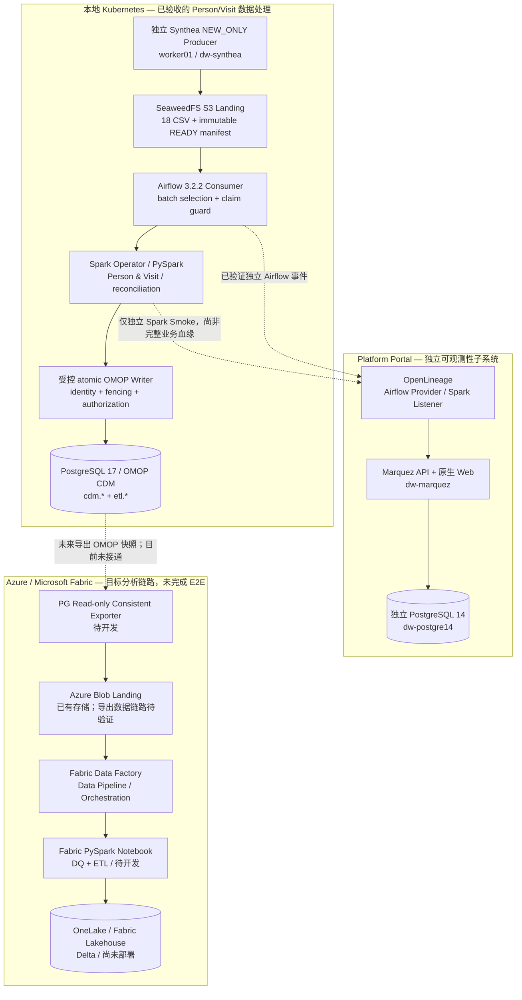

# Healthcare Data Platform — 总体系统架构

> **权威范围**：本文件是已核对的当前 **overall architecture**。只陈述主链路、子系统职责和目标方向；模块实现细节留到后续 `documents/components/`，操作步骤留给 Runbook，需求变更将来交给 OpenSpec。
>
> **核验方法**：基于 Healthcare Main `8d276dc7a121c15396a9ce328fcfea4688a795ae` 的 DAG、K8s/Portal/Terraform 源码和截至 2026-10-15 的真实验收记录做**文档与源码只读核对**，未在本次整理中执行 Live Cluster / Azure / PostgreSQL 操作。部署类陈述均标注其对应的**历史验收范围**，不是 2026-10-16 的实时可用性探针。

## 1. 一张整体架构图

**图例**：实线是各子系统的设计或已实现的内部数据流，状态由所在分组和下表判定；虚线为跨系统观测/未来依赖。**实线不表示整个云端执行已成功。** Portal 的 Spark Listener 已由独立 Smoke 证明真实发出事件，但尚未形成完整 TASK004 数据集血缘。

## 2. 系统分工及验收边界

| 子系统 | 当前职责 | 到 2026-10-16 可支持的结论 |
| --- | --- | --- |
| Kubernetes & local storage | SeaweedFS、Airflow、Spark、PG 的容器调度和持久卷；NEW_ONLY 生成与消费解耦 | 有真实运行和存储验收；**本轮未重做在线探针** |
| [Synthea NEW_ONLY](../../kubernetes/manifests/synthea/new-only/) | 独立生成/校验/发布不可变 S3 Batch，Airflow 不启动 Generator | NEW_ONLY 的真实新批次生产 + 下游消费已被验收；UPDATE_ONLY / MIX_DATA 未完成 |
| [Airflow](../../airflow/dags/new_only_omop_consumer.py) + [Spark CODE](../components/spark/CODE.md) | 手动选择 READY Batch；合法 Claim 路由后处理 Person/Visit，再进行 reconciliation / writer handoff | 新批次 Airflow Person/Visit → PostgreSQL 写入、同一已提交批次 SKIP 均有独立证据；不代表所有模式已自动运行 |
| [PostgreSQL OMOP CODE](../components/omop/CODE.md) | Person/Visit ID Map、CDM、事务 Claim / Stage / Commit、真实读回 | TASK004 对已指定 NEW_ONLY 批次的 atomic COMMIT 验收通过；Condition/其他域未完成 |
| [Platform Portal](../../platform-portal/README.md) | Airflow/Spark lineage 可观测性，不是业务 ETL 的 Producer/Writer | Marquez 和原生 Web、Airflow A3 真实事件、Spark A4 独立 Smoke 已测试；Job/Run 对应与 Dataset I/O 完整血缘仍未通过 |
| [Azure + Fabric](../../azure/infra-terraform/README.md) | 本地 OMOP 作为**来源权威**，导出一致性快照至已有 Azure Blob，再由 Fabric Pipeline+Notebook 将数据写入 OneLake Lakehouse | Storage/Workspace 既有；3 个 Fabric item **Terraform Plan PASS**，但未 Apply、Notebook/Exporter/业务 Pipeline 未完成，OneLake ETL 无 E2E |

### 当前明确区分的两个 landing

- **SeaweedFS S3 Landing**：源于 Synthea 的 18 CSV 批次，本地 Airflow→Spark→OMOP 链路的数据源；已经有真实发布和消费证据。
- **Azure Blob Landing**：未来从 **PostgreSQL OMOP 已完成数据**导出后的云端快照交接区；不是替换当前 Synthea S3 Landing，也不是让 Fabric 重跑 Person/Visit 的原始 Canonical ETL。

两者属于不同阶段和不同数据语义，不需要在第一阶段搭建跨云统一调度或重做本地 OMOP 写入逻辑。

## 3. 核心架构决策与被取代方案

| 领域 | 现在采用的方向 | 已取代或推迟 |
| --- | --- | --- |
| Synthea → Airflow | 独立 Producer 发布 READY，Airflow 从 S3 消费并受控提交 | V4 中「Airflow DAG 负责生成 Synthea」属于已被取代的历史 Processing-first 模式 |
| NEW_ONLY / UPDATE_ONLY / MIX_DATA | 三种 Producer 身份独立；仅 NEW_ONLY 有完整入库验收 | 旧名称 EXISTING_ONLY / MIXED 不再用作正式身份；后两种仍设计阶段 |
| Airflow 调度 | 业务 `new_only_omop_consumer` 手工触发、独立 Writer 授权；`landing_batch_discovery` 每 15 分钟可发现，但默认不自动 Claim/业务提交 | 「自动发现」不能直接写成「所有 READY 自动入库」 |
| Portal | OpenLineage + Marquez 官方 Web，独立 PG14 元数据 | 暂不开发自定义 Portal UI、Superset/OpenMetadata/Kafka |
| Azure 分析 | PostgreSQL → 快照 → Azure Blob → **Fabric Data Pipeline** → PySpark Notebook → OneLake Lakehouse | 旧 Warehouse-first / 多层云端重做 ETL 非当前 MVP；Warehouse 和高级 marts 可选后续 |
| 仓库工作方式 | 同一 Healthcare Repo 保存源码/新 `documents/`；Self-Runner 执行；OpenSpec 尚未初始化 | 不另建独立文档服务，也不把尚未实现目标当成已验收行为 Spec |

## 4. 为什么 Azure 路线要简化

本地已经用 Spark + OMOP Writer 完成 Person/Visit 标准化处理。Azure 阶段的 MVP 目标是**把已标准化的数据搬到分析环境**，而不是重复构建源头 Synthea/FHIR/HL7 转换层。由此：

1. 本地 PostgreSQL OMOP 保持关系数据权威；云端 OneLake 是面向分析的副本，不反写本地数据库。
2. 导出器只需提供一致性快照和完整性校验；先做少量 OMOP 表，再按需扩展。
3. Azure Blob 保存导出数据和可验证 manifest；Fabric Data Pipeline 负责触发/编排后续 Notebook，不承担 Notebook 的 PySpark 处理逻辑。
4. Notebook 完成 Blob → 质量检查 → Delta/Lakehouse 加载；Warehouse、dbt 和高级编排**不阻塞**首个云端 E2E。
5. 将独立 ID、Manifest/Hash、数据一致性和重试幂等要求显式定义，再开始开发，避免缩短工期时牺牲数据可信度。

这一简化已经落实到 Terraform 目标 Item 定义，但 exporter、Notebook 业务处理、Pipeline 真实依赖尚需实施和验收。具体设计与资源见 [Data Flow](DATA-FLOW.md) 和 [Infrastructure](INFRASTRUCTURE.md)。

## 5. 下一步与不应混淆的范围

- 当前 TASK004 的 Person/Visit NEW_ONLY 验收范围为 **COMPLETED**；[最终 E2E Closeout](https://github.com/JohnZhang-DataForge/healthcare-data-platform/blob/49936b51d4beadc69383e931efc3e72d2f0db47e/docs/tasks/TASK-004-NEW-ONLY-E2E-FINAL-ACCEPTANCE-2026-10-14.zh-CN.md)、[PG 独立读回](https://github.com/JohnZhang-DataForge/Self-Runner/actions/runs/38657060822)、[同批次 SKIP](https://github.com/JohnZhang-DataForge/Self-Runner/actions/runs/38657630069)。
- Condition TASK005 仍是 STEP00 只读预检阶段，不得推断已实现 Condition CDM 加载。
- Portal 的 A3/A4 是分项验收，不能据此声明 `Synthea → OMOP` 业务 Dataset 血缘完整。
- Azure 最小三组件 Plan PASS **不代表** Data Factory Notebook 真实运行、OneLake 已存在、Fabric Workspace/Capacity 由 Terraform 创建或云端数据已入库。
- 运行前查看 [Agent Rules](../development/AGENT-RULES.md)、[Development Workflow](../development/DEVELOPMENT-WORKFLOW.md)。本文件本身不授权任何新的 Runtime Mutation。

## 6. 依据与来源

- 历史 [V4 总设计](https://github.com/JohnZhang-DataForge/healthcare-data-platform/blob/49936b51d4beadc69383e931efc3e72d2f0db47e/docs/architecture/Healthcare-Data-Platform-Architecture-and-Implementation.v4.zh-CN.md)（仅用于旧方案演进追溯）、[独立 Synthea 提案](https://github.com/JohnZhang-DataForge/healthcare-data-platform/blob/49936b51d4beadc69383e931efc3e72d2f0db47e/docs/architecture/TASK-004-INDEPENDENT-SYNTHEA-GENERATORS-AND-AIRFLOW-CONSUMER-v1.0.zh-CN.md)。
- [Portal A3 实测](https://github.com/JohnZhang-DataForge/healthcare-data-platform/blob/49936b51d4beadc69383e931efc3e72d2f0db47e/docs/platform-portal/PORTAL-A3-AIRFLOW-OPENLINEAGE-REAL-LIVE-CLOSEOUT-2026-10-13.zh-CN.md)、[Portal A4 独立 Spark 实测](https://github.com/JohnZhang-DataForge/healthcare-data-platform/blob/49936b51d4beadc69383e931efc3e72d2f0db47e/docs/platform-portal/A4-SPARK-OPENLINEAGE-REAL-SMOKE-2026-10-14.zh-CN.md)。
- [Azure OneLake-first 和三个真实 Plan](https://github.com/JohnZhang-DataForge/healthcare-data-platform/blob/49936b51d4beadc69383e931efc3e72d2f0db47e/docs/azure-fabric/AZURE-ONELAKE-INFRA-PLAN-ONLY-2026-10-15.md)、[Azure Terraform 架构](../../azure/infra-terraform/docs/ARCHITECTURE.md)。
