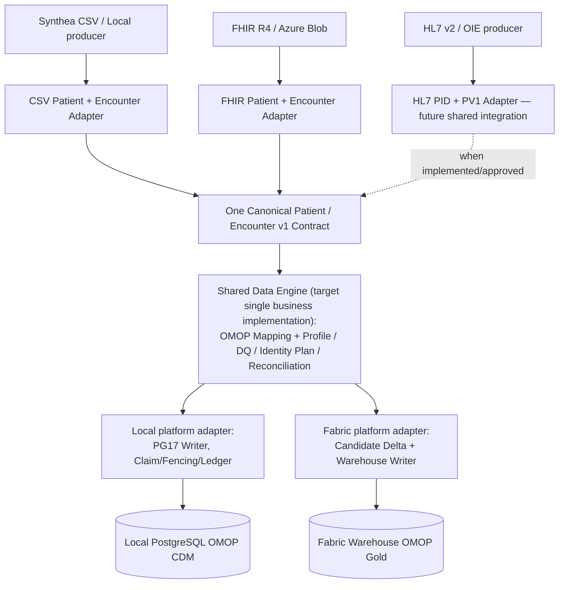

# Healthcare Data Platform — 总体系统架构

> **当前业务架构入口（2026-11-06）**。临床转换语义以 [2026-10-30 Medallion Canonical ADR](design/FABRIC-MEDALLION-CANONICAL-ADR-20261030.md) 为准；Notebook/Pipeline/Environment 和唯一 Wheel 以 [2026-10-31 Fabric-native ADR](design/FABRIC-NATIVE-NOTEBOOK-PIPELINE-ENVIRONMENT-ADR-20261031.md) 为准；[Shared Engine 所有权](../engineering/development/SHARED-DATA-ENGINE-STRUCTURE-AND-OWNERSHIP.md) 决定实现位置。本文只做跨系统总览，**不替代** ADR、[Data Flow](DATA-FLOW.md) 或具体业务 [OpenSpec Tasks](../../openspec/changes/fabric-fhir-omop-unified-e2e/tasks.md)。
>
> **重要纠偏**：2026-10-16 旧总览仅将 Fabric 描述为「Local PG → Azure → OneLake 分析副本」，现已不再代表完整的当前架构。2026-10-30/31 正式增加了独立的 FHIR→Canonical→OMOP Fabric 开发主线；两条产品路线可以并存，但 PG 快照复制**不是** FHIR Intake 的前置条件。这里的运行状态按既有 Git/CI/独立读回证据表述；本次文档修正没有进行实时云端探针或任何数据写入。

## 1. 核心原则：来源独立、Canonical 统一、计算复用、发布分平台



- **Source/Entity Adapter** 只负责原始格式、来源身份、数据语义到 Canonical 的差异；不得复制下游 OMOP Mapper。具体来源的 FHIR/HL7/CSV Code → OMOP Concept 语义通过**审核过、版本化的 Mapping Profile**输入共享逻辑，不能依据字面代码或错误 OMOP Domain 猜测值。
- **Canonical 合同唯一**：已冻结的 [Local Patient v1 / Encounter v1](../../local-data-platform/spark/contracts/canonical/) 是当前手工维护权威，Shared 依精确 Hash 校验；不为 Fabric 复制第二套合同。真实 FHIR 不符合 v1 的字段应 Quarantine 或另审 v2，不能造医学默认值。
- **Silver/Gold 语义**：Fabric Bronze 保存可验证原始事实，持久 Silver 存 Canonical Patient/Encounter，只有通过 DQ/FK/独立读回并经 Approval 的版本才可进入共享 Mapper；Candidate 不等于 Gold COMMITTED。稳定 ID Preview 不等于正式 ID Map。
- **同一业务处理引擎是批准的目标，不是已经完成的双平台重构**：现有唯一 `healthcare_data_engine` 0.1.6 已正式发布 Fabric，并提供 FHIR Adapter、Canonical、DQ/Reconciliation、Identity Snapshot/Concept/FK 规则及 OMOP Candidate；既有 Local CSV→OMOP 运行链仍保留历史 Local Python/SQL 及其真实 PG Writer。Local 逐模块提炼、行为等价验证、版本化迁移后才可声称两个 Runtime 完全使用同一实现。
- **物理 Writer 是平台责任**：Local PostgreSQL 的 SQL/Sequence/锁/事务不能原样复制到 Fabric Warehouse；共享包不执行 Blob/S3/Delta/PG/Warehouse I/O，且只有受控单写入者的 Fabric Gold 事务与读回才能提供 Gold COMMITTED 证据。

## 2. 两条不同的 Fabric 数据路线

### A. FHIR → Canonical Silver → OMOP Gold（现行实施主线）

```text
Azure Blob FHIR R4 + manifest/object SHA
  → Fabric native Pipeline + nb_fhir_ingest Spark
  → Bronze: verified raw facts / receipt
  → Shared FHIR Adapter + Canonical DQ
  → Silver Delta: canonical_patient / canonical_encounter + quarantine / Approval
  → Shared OMOP Candidate Mapper + reviewed Concept Profile + stable ID plan
  → Candidate Delta + independent readback / approval
  → single-writer Warehouse transaction:
       identity_map + allocator + cdm.person + cdm.visit_occurrence + ledger
  → independent SQL readback + replay verification
```

**验证边界（截至 2026-11-06 Git/Run 证据）：**

| 阶段 | 可证明的范围 | 尚不能声称 |
| --- | --- | --- |
| Shared Wheel / 业务 Notebook | **0.1.6** GA Published、正式 Notebook Git 独立读回、Spark 4.1 正式业务 import-only RUNTIME_SMOKE **PASS**（[GA Run](https://github.com/JohnZhang-DataForge/Self-Runner/actions/runs/42284453546) / [Notebook Git](https://github.com/JohnZhang-DataForge/Self-Runner/actions/runs/42291355563) / [Runtime](https://github.com/JohnZhang-DataForge/Self-Runner/actions/runs/42297766098)） | Local 生产链已迁移、真实 Candidate/Gold/Pipeline E2E |
| G3/G4 | 受控合成 FHIR Bronze；Approved Silver **100 Patient / 5,918 Encounter / Quarantine 0** 的物理 Delta 写入、读回、重跑 SKIP | Candidate/Gold 已写入 |
| F0/F1 | Warehouse 39 个 OMOP CDM Core 空表、9 个 Vocabulary 表以及 5 个 ETL/Audit 管理表已部署并分别读回 | 已有临床 Person/Visit Gold 数据 |
| G5/F2 | G5 Silver 来源只读探针、真实源代码词频及 Vocabulary lexical lookup；稳定 INT Identity Preview；合成 SQL ROLLBACK 演练 PASS | 正式 Concept Profile 获临床审核、持久 Identity Map、Candidate Delta/Gold COMMIT |
| Pipeline E2E | 原生 Notebook/Pipeline/Environment/Lakehouse Item 已存在；正式默认 HALT | 已完成 FHIR→Warehouse Gold Pipeline 端到端 |

F1 Vocabulary 的 release/manifest/许可审计、FHIR Concept 的正确 Domain 和临床映射审查仍是 HOLD；后续顺序仅由 [Fabric FHIR→OMOP E2E Active Change](../../openspec/changes/fabric-fhir-omop-unified-e2e/tasks.md) 管理。不要使用词汇匹配结果或离线 CI 冒充正式 Gold 验收。

### B. Local PostgreSQL OMOP → Fabric 分析副本（独立未来数据产品）

```text
Local PG17 committed CDM → read-only consistent snapshot Exporter (not implemented)
  → versioned Azure Blob snapshot + manifest (not validated E2E)
  → Fabric native orchestration / Notebook → analytical OneLake replica (future)
```

这一路线消费**已经标准化的 OMOP 数据**，不需要重新走 CSV/FHIR Adapter 和 Canonical。Local PG 仅是本地 CDM 数据的事实权威；Fabric 原生 FHIR Gold 是另一条需独立验收的业务写入链，**不应**假设两端已经实时同步。旧 2026-10-15 的 Terraform Plan-only、未来 Exporter 和拟议 `nb_omop_snapshot_load` 记录仅作历史设计参照，不能覆盖 2026-11-05 已存在的 Native Items/Warehouse 事实。

## 3. 系统与代码职责

| 系统 / 能力 | 唯一入口 | 现状边界 |
| --- | --- | --- |
| Local DP | [组件目录](../systems/data-platform/README.md) / [OMOP Writer](../systems/data-platform/omop/README.md) | Synthea CSV→Airflow→Spark→PG17 Person/Visit NEW_ONLY 有受控真实 COMMIT、读回与 SKIP 证据；其它域与 Shared 生产替换另审 |
| Shared Data Engine | [说明与版本](../systems/data-platform/shared-engine/README.md) / [CODE](../systems/data-platform/shared-engine/CODE.md) | 唯一平台无关业务 Wheel 0.1.6，Fabric 已发布+正式 Notebook 只读实机 PASS；Local 仅维护、后续逐步接入 |
| Azure / Fabric | [系统入口](../systems/azure-fabric/README.md) / [CODE](../systems/azure-fabric/CODE.md) | FHIR Bronze/G4 Canonical Silver 已验收；Gold Candidate/正式 Warehouse COMMIT/E2E 开放 |
| Portal / Lineage | [系统入口](../systems/platform-portal/README.md) | Marquez + PG14 与业务 Writer 分离；业务级跨 Local/Fabric Dataset/Job 血缘需要独立验证 |
| Runtime 安全 / 任务 | [Safe Operations](../engineering/operations/SAFE-OPERATIONS.md) / [Active OpenSpec](../../openspec/changes/) | PR/CI/运行授权分开，设计与离线通过都不构成云端写入许可 |

## 4. 2026-11-06 通用架构 → Fabric 主开发交接

- **核心现状：FABRIC_READY_CORE，不是 BUSINESS_E2E_DONE。** Source Adapter → 单一冻结 Canonical Patient/Encounter v1 → Shared Engine 0.1.6 的统一组件责任与跨 Runtime 合成等价已成立；真实发布与正式 Notebook import-only Spark 4.1 PASS，默认 `HALT`。不需要先完成 Local 的 Shared Wheel 生产迁移才能继续 Fabric。
- **Local 策略：maintenance only。** 既有 Synthea CSV→Airflow/Spark→Local PostgreSQL Person/Visit 可以维持运行，不主动迁移 Mapper/PG Writer；仅兼容或故障修复。Local 完整迁移及第三实体 Condition 扩展仍在 [Shared Multi-Entity tasks](../../openspec/changes/extend-shared-omop-multi-entity/tasks.md) 保留。
- **Fabric 正式后续业务**：[统一 FHIR→OMOP E2E tasks](../../openspec/changes/fabric-fhir-omop-unified-e2e/tasks.md) 驱动 P1.4/P1.5（Vocabulary Release/License + 临床 Mapping Profile）、P2.1（物理 Warehouse Identity Map/Allocator/Ledger 快照）、P3.1（Candidate Delta/Approval-last/Replay）、P4.1（单事务 Gold）、P5.1（Native Pipeline E2E）。Snapshot/Preview 不等于持久 ID；候选/源码 CI 不等于已完成真实 SQL。
- **跨来源与新实体未来验证**：HL7/dbt 仍为独立适配/实验，Condition 为第三实体增量兼容证明；不重新开发 Shared Mapper，不提前扩展全部 39 表。

## 5. 不变式及阅读顺序

先读**本总览 → Medallion Canonical ADR → Fabric-native ADR → Shared Engine Ownership → 相关组件 README/CODE → Active OpenSpec Tasks → 现行真实源码和确切 Run**。后续系统架构变更必须同步更新这条导航，不能让过期设计继续标记为“当前”。变更源码需在 OpenSpec 和源码归属图中明确重用与平台边界。

历史 Local PG Snapshot-first 总览已由 Git 永久保留（例如 [旧总览固定提交](https://github.com/JohnZhang-DataForge/healthcare-data-platform/blob/8d276dc7a121c15396a9ce328fcfea4688a795ae/documents/architecture/SYSTEM-OVERVIEW.md)）；不在当前目录维护第二份相冲突的活跃总览。
